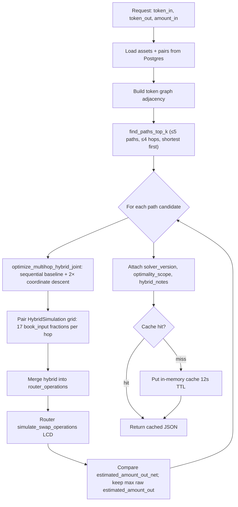
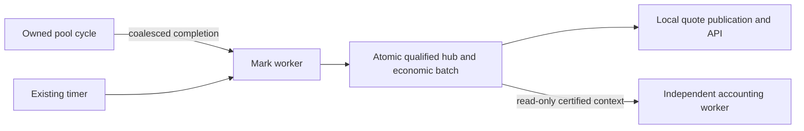

# Route solver — in-depth guide

## Economic attribution (#1483)

The optional `economic_attribution` object explains the existing aggregate
fair-reference deviation without changing route ranking, independent references,
protection or execution. See [RC1483](../skills/AGENTS_ROUTE_COST_ATTRIBUTION.md)
and [verification/checklist](qa/issue-1483/README.md). It is a spot bridge, not an
independent oracle, executable counterfactual or network-fee estimate.

Available schema version 1 uses fixed `status:"available"`,
`method:"spot_bridge_v1"`, `generation`, `observed_at_ms`, `expires_at_ms`,
`fair_amount_out`, `net_amount_out`, exactly four `components` and fixed
`dominant_cause`. The fair/net fields match `spot_amount_out` and delivered
`estimated_amount_out_net`; context/time fields match original execution metadata.
Components `wrapper_loss`, `trading_cost`, `market_movement` and
`reference_divergence` are canonical signed raw integers in final-output units,
each magnitude bounded by Uint128. No per-hop percentages are added. Unavailable
schema contains only version, status and method; it cannot manufacture zero costs.

For each original hop define `P_i(x) = floor(x * reserve_out_i / reserve_in_i)`
and `P_suffix` as their ordered composition, with one floor per remaining hop.
Let `F` be independent fair output, `G` authorized gross input, `C` credited
route input, `R` final route net and `N` delivered wallet net. Reference divergence
is `F - P_all(G)`. Wrapper loss is
`P_all(G) - P_all(C) + R - N`, so native wrap/unwrap is counted once. Trading
cost sums differences of projected actual gross/economic sell boundaries,
pre/post commission boundaries, supported hook boundaries and buy-net boundaries.
It includes actual pool/book taker commissions, taxes and sell residue. Market
movement sums projected economic spot minus projected actual precommission
returns, retaining signed favorable book execution. Actual net of each hop is
the next hop's input. Those adjacent boundaries telescope exactly:

`wrapper_loss + trading_cost + market_movement + reference_divergence = F - N`.

Integer truncation belongs to its stage in that ordered bridge. Reconciliation
has **zero raw-unit residual**; a continuously valued counterfactual can allocate
rounding differently and is not claimed. Missing reserves/stages, incompatible
boundaries, overflow or reconciliation failure yields unavailable attribution.
Original fair quality, times and $10 economic/$100 independent depth admission
are unchanged. The largest absolute component selects the fixed dominant cause;
ties yield `mixed`, and signed favorable offsets retain their direction.

The existing single retail percentage is `100 * abs(F - N) / max(F, N)`.
It is distinct from selected slippage tolerance, L9 AMM spread, gas and network
fees. Exact raw fraction thresholds govern >5%, >30% and >=99% before display
rounding. Legitimately high best quotes retain their warnings. Exact-amount
results and skeleton reuse still compare supported eligible alternatives within
the original work caps; the new same-cohort fixture proves a small cached direct
winner yields to the better deep two-hop route at a larger amount. Native routes
remain pool-only; unsupported output capabilities remain explicit blockers.

Bounded deeper work publishes every strictly better eligible raw net result;
the previous undocumented 0.1% improvement cutoff has been removed. An independent
same-generation fixture retains the initial direct baseline, then requires its
cached result to improve by approximately 0.05% through an eligible three-hop
path. This improves later quotes without replacing any already reviewed intent.
Per-hop `book_commission_amount` separately records actual book taker commissions;
existing `commission_amount` retains its pool-commission meaning.

Actual Swap and Trade use the plain **Price difference** label and a compact
fixed cause explanation only after client schema/reconciliation/quote binding
checks. Ordinary <=5% details stay behind existing Signing details. Higher-risk
quotes and confirmation share one actionable notice, and active blockers have
one presentation priority. Missing or tampered advisory diagnostics are silent
in the primary flow. Every execution gate still applies independently.
Diagnostics cannot authorize signing or replace
original gross input, generation, expiry, positive floors or offline fee budgets.
Remaining protocol/reference/device/deployment limits are recorded in
[results](qa/issue-1483/RESULTS.md).

## Local quote contract (#1452)

Current amount-sensitive GET `/route/solve`, `/best`, POST and progress requests
consume immutable locally published observations. The separately scheduled
worker owns chain identity, eligibility/configuration reads and mirror loading.
Initial results, deeper search, reference pricing, refresh and frontend reviewed
route preparation do not perform chain queries. An uninitialized or unsupported
observation fails explicitly; requests cannot accelerate ingestion.

Route selection scores checked integer output against the caller's `max_spread`
constraint and emits positive per-hop `min_return` and final receive floors from
that observation. Direct and one-intermediate candidates precede bounded local
longer-path work. A useful baseline returns before deeper improvements. Cache
identity includes exact input or target and market generation; responses cannot
be linearly scaled or synchronously enriched by remote reference solves.

This is a bounded heuristic, not a global optimum. L9 market spread, post-hook
net floors and fair-reference deviation remain separate protections. Confirmed
input, operations, floors, constraints and observation expiry are pinned until
signing; refresh cannot silently substitute the reviewed transaction.

Read [LQ1452 invariants](../skills/AGENTS_LOCAL_SWAP_QUOTES.md),
[agent verification instructions](qa/issue-1452/README.md) and
[implemented scope and measured results](qa/issue-1452/RESULTS.md).
Unsupported semantics and unavailable live checks remain explicit there. Local
microbenchmarks never establish production browser acceptance at the currently
accepted temporary ≤500 ms target. The original <250 ms improvement is deferred
per [#1464](qa/issue-1464/README.md); historical timing verdicts remain unchanged.
For #1473 controlled/deployed browser verification, the user temporarily set a
named ≤750 ms criterion on 2026-10-11; [its checklist](qa/issue-1473/README.md#temporary-browser-latency-criterion)
retains prior 500 ms failures without reclassifying them. Separate socket budgets
and economic protection percentages are unchanged.
Independent reserve/book generation and provider-feed recovery remain coordinated
with [#1453](https://git.cl8y.com/code/cl8y-dex-terraclassic/issues/1453).

### Current work and observation budgets

| Resource | Bound |
| --- | --- |
| Asset rows / discovered contract identities / pair rows | 2,048 / 512 / 512, deterministic order |
| Actor observations / retained contexts | 8 rotating recent (from a 120-wallet census) + 8 rotating historical observations per pass; 2,048 stored contexts, known blocks never evicted; unknown actors use full-fee estimates without wallet-specific approval |
| Graph work / returned structural candidates | 16,384 edge visits / 1,024 paths, at most four hops |
| Initial book alternatives | Pool-only, half-book and full-book on hop zero; compare emitted plans with L9 and material-pool checks |
| Mirrored book rows | 500 per side per pair; excessive/invalid required mirrors fail explicitly |
| Exact-output sizing | At most 64 pool candidates; checked integer inverse and local forward sufficiency, positive target floors |
| Cached results / skeletons / namespaces / concurrent deeper jobs | 256 / 128 / 32 / 4; exact results, namespace/topology/freeze-bound skeletons, coalesced jobs with cleanup |
| Configuration admission | Nonoverlapping 2 s cadence, 60 s slice deadline; 8 pairs per slice; original per-pair 180 s validity ceiling and 6 s dependent-check deadline |
| Local reserve/reference publication | Nonoverlapping 2 s cadence and 2 s pass deadline; original observation times retained |
| Wrapper observation | 10 s cadence, 8 s deadline, 20 s observation-age ceiling |
| Quote-worker provider traffic | Two data-request permits, one aggregate request start every 250 ms; 64 KiB response ceiling, 32 KiB config and 8 KiB wrapper sublimits |

Configuration admission rotates through bounded slices and publishes each completed
pair before continuing. Failed checks remove pending admission without renewing its
old timestamps. Each quote checks its own pairs' configuration expiry; an expired
unrelated edge cannot disable a fresh corridor. Provider delay can still expire
observations, so largest-factory production liveness needs separate evidence.
See [incremental admission and recovery](qa/issue-1452/FOLLOWUP-INGESTION.md). Ordinary code identity, pair pins,
hook configuration/order, registry wiring, known actors, references, books,
reserves, wrapper semantics and local freeze membership invalidate generations.

A known block survives census omission and failed reads; an explicit fresh unblock
clears it even if fee data is missing. Historical negatives rotate independently
of request traffic. At the 2,048-context limit, fee contexts may be discarded,
but losing a known block is forbidden. Overflow immediately quarantines local
quotes, cache hits, topology and progress; the 32-namespace quarantine registry
fails closed if it is exhausted. No reset based on a partial census is allowed.
Recovery requires a complete pinned-height raw inventory from the canonical factory
layout, including a terminal page and unchanged configuration epoch. Missing,
partial, stale or oversized inventory leaves quarantine intact. This runtime
capacity boundary is distinct from verification skips.

Supported local v1 community-tax forward and pool receive sizing account for exact
gross funding, sell residue, hook deductions and buy tax. Named actors require
scheduled per-token identity and wallet-cap observations; enabled AutoLP and
unobservable cooldowns fail explicitly. See [tax scope](qa/issue-1452/FOLLOWUP-TAX.md).
Deducting-hook inverse uses observation-time residue tables, preserving independent
rounding collisions. Manual split POST binds every exact hop budget and maker cap.
Direct zero-hop wrapper arithmetic/sizing is available with
`execution_supported:false`; signing remains blocked because the external
protocol cannot enforce a receive floor. See [mode scope](qa/issue-1452/FOLLOWUP-MODES.md).
Known actor discounts apply only to pairs with the matching observed registry;
unknown wallet blacklist/tier context cannot be represented as fresh approval.
On-chain blacklist, launch, tax, wallet funding and positive settlement floors
remain authoritative. See [remaining scope and receipts](qa/issue-1452/RESULTS.md).

## Historical request solver reference

The pipeline, top-five/32-path optimality scope, LCD budgets, 12/15/30/90-second
TTL enrichment and live-query fallback descriptions below document the previous
request implementation. They are superseded by the local quote contract for the
current request path. Contract reverse-query/provider budgets remain applicable
independently; do not relax them when replacing indexer quote arithmetic.


## Route launch guards (#1390)

Logical routes visit the first offer and each ask once. Repeated route-tax-capable
assets are rejected by execute, forward/reverse quotes, solver and client
preflight even with zero rates, disabled guards or an exempt manager. Ordinary
intermediate buy/sell remains valid; independent routes keep per-wallet cooldown.
Only authenticated original-input residue restored to its payer can bypass
max-wallet. Bought output, intermediate residue and other recipients remain
capped. Protocol-exempt routed traders are rejected in previews and execution.
See [LG1390 invariants](../skills/AGENTS_ROUTE_LAUNCH_GUARDS.md) and
[agent review/verification checklist](qa/issue-1390/README.md).


## Route-local tax funding (#1381)

Funding version **1** follows [RT1381-1–RT1381-10](../skills/AGENTS_ROUTE_LOCAL_TAX.md)
and the [protocol/migration runbook](./runbooks/route-local-tax-1381.md).
Router input is a gross budget; taxes consume only this route's funds, pair credit
matches the declared economic hook amount, and pair→router buys are charged once.
Supported taxed intermediates remain eligible with net executable ranking. Older
T592-13/R607/R615 wallet-extra-debit, raw-output and middle-hop exclusion descriptions
in the historical sections below describe legacy deployments only. They are
superseded for v1; direct-pair Sell/SendFrom compatibility remains unchanged.
[QA evidence and agent checklist](./qa/issue-1381/README.md); `make verify-issue-1381`.

Authoritative reference for contributors and integrators using **`GET` / `POST /api/v1/route/solve`**. The solver is **advisory**: on-chain **`max_spread`** / **`min_receive`** at execute time are authoritative. This document expands [ADR 0002](./adr/0002-global-best-execution-route-solver.md) (decision record) with the current local quote contract above superseding request-time network work.

Pair-direct integrators use this same best-execution API: optimized GET requires `amount_in`, and a one-hop pair-direct call must execute with that hop's returned `hybrid` params; omitting hybrid on a direct pair swap remains pool-only under the current contract ([I707 guide](./integrators.md#pair-swap-pool-only-vs-best-execution-forgejo-707)).

**Related:** [indexer-invariants.md](./indexer-invariants.md) (HTTP matrix), [integrators.md](./integrators.md#route-discovery-and-quotes-l8), [skills/AGENTS_INDEXER_HYBRID_BEST_EXECUTION.md](../skills/AGENTS_INDEXER_HYBRID_BEST_EXECUTION.md).

**F6 freeze:** `find_path` / `build_adjacency` skip frozen hops (`code_id_frozen` cache). A frozen-only market returns **404**. See [indexer-invariants.md](./indexer-invariants.md) GitLab **#585**.

---

## Glossary

| Term | Meaning | JSON / code |
|------|---------|-------------|
| **Token graph** | Undirected graph: nodes = indexed CW20 assets (`assets.contract_address`); edges = indexed pairs (`pairs`). Native-only assets without a contract address are **not** routable (`token_in=uluna` → **400**). Retail Swap wrap-maps `uluna`→cLUNC / `uusd`→cUSTC **on the client** before GET ([#1218](https://git.cl8y.com/code/cl8y-dex-terraclassic/issues/1218)). | Built in `route_solver.rs` / `route_paths.rs` from Postgres |
| **Hop** | One swap leg: a pair contract, an **offer** CW20, and an **ask** CW20. | `hops[]`: `{ pair, offer_token, ask_token }` |
| **Path** | A simple (no repeated asset) sequence of hops from `token_in` to `token_out`. | `intermediate_tokens`: `[token_in, …, token_out]` |
| **Pool-only leg** | Constant-product AMM only; router op has `terra_swap.hybrid: null` (on-chain this is pool-only hybrid with `book_input = 0`). | `quote_kind`: `indexer_pool_lcd` or `indexer_route_only` |
| **Hybrid leg** | Split between pool and limit book: `pool_input + book_input = offer` for that hop. Retail **GET** attaches this only on **hop 0**; hops 1+ stay `hybrid: null` ([#1280](https://git.cl8y.com/code/cl8y-dex-terraclassic/issues/1280)). | `router_operations[].terra_swap.hybrid` |
| **`book_input` / `pool_input`** | Raw integer strings: offer amount routed to the limit book vs the AMM pool on one hop. | `HybridHopJson` in POST body / merged ops |
| **`book_start_hint`** | Optional order id to start the book walk on the **matcher side** for that hop (bid hint when offering token0, ask hint when offering token1). The global optimizer (`global_v2`) sets this to the first **live** resting order on that side when the Postgres mirror is fresh and `book_input > 0`; stale/missing mirror or pool-only hops leave it `null` ([#332](https://gitlab.com/PlasticDigits/cl8y-dex-terraclassic/-/work_items/332), [#289](https://gitlab.com/PlasticDigits/cl8y-dex-terraclassic/-/work_items/289)). Same hint is used in mirror/LCD `HybridSimulation` grid evals and in returned `router_operations`. Wrong-side hints are omitted server-side; on-chain validation (**L17**, [#272](https://gitlab.com/PlasticDigits/cl8y-dex-terraclassic/-/issues/272)) remains authoritative at execute time. | `HybridHopJson.book_start_hint` |
| **`RouteQuoteKind`** | How the quote was produced. | `quote_kind` (snake_case enum) |
| **`indexer_route_only`** | Topology only — no `estimated_amount_out` (missing `ROUTER_ADDRESS` and/or `amount_in`, or sim failed). | `RouteQuoteKind::IndexerRouteOnly` |
| **`indexer_pool_lcd`** | Pool-only router ops; LCD `simulate_swap_operations` when configured. | |
| **`indexer_hybrid_lcd`** | At least one hop has a non-zero book leg after optimization. | |
| **`indexer_hybrid_lcd_degraded`** | Hybrid grid failed on at least one hop; fell back to pool-only `HybridSimulation` (`book_input: 0`). | `OptimizationMeta.degraded` |
| **`solver_version`** | Solver generation label on global best-execution GET responses. **`global_v1`** (LCD grid) or **`global_v2`** (Postgres mirror grid when `ROUTE_SOLVER_DB_HYBRID=1`). | `best_execution::SOLVER_VERSION_LCD` / `SOLVER_VERSION_DB` |
| **`optimality_scope`** | Human-readable bound on what was searched — **not** a guarantee of global optimum over all paths or splits. | `best_execution::OPTIMALITY_SCOPE` |
| **`hybrid_notes`** | Model limits, degradation, and liability boundary for clients. | Built in `hybrid_notes_for_global` |
| **Degraded hybrid** | Per-hop: all 17 grid `HybridSimulation` candidates failed; solver uses pool-only fallback for that hop. | `quote_kind` → `indexer_hybrid_lcd_degraded` |

---

## Pipeline (global best execution)

Applies when **`GET /api/v1/route/solve`** (or **`/best`**) is called with **`amount_in`** set and **`pool_only` is not true**.



**Discovery-only GET** (no `amount_in`, or `pool_only=true`): **first** BFS shortest path only — no top-K enumeration, no hybrid optimizer. POST always uses first BFS path (max **4** hops) plus optional client `hybrid_by_hop`.

### Code map

| Stage | Module | Function / constant |
|-------|--------|-------------------|
| Graph + BFS (legacy) | `route_solver.rs` | `find_path`, `resolve_route_with_max_hops` |
| Top-K paths | `route_paths.rs` | `find_paths_top_k`, `PATH_ENUM_POOL` (= 32) then `select_usable_top_k` → `MAX_PATH_CANDIDATES` (= 5 usable) |
| Global winner | `best_execution.rs` | `solve_global_best_execution` |
| Per-hop / joint hybrid | `hybrid_route_opt.rs` | `optimize_multihop_hybrid_joint`, `GRID_POINTS` (= 17), `COORDINATE_PASSES` (= 2) |
| Router sim | `route_solver.rs` | `maybe_simulate` |
| Response cache | `route_solver.rs` | `ROUTE_CACHE_TTL`, `ROUTE_CACHE_TTL_DISTANT`, `hybrid_cache_key` |
| Graph snapshot cache | `route_graph.rs` | `ROUTE_GRAPH_CACHE_TTL`, `get_route_graph_snapshot` |
| Solve progress poll | `route_solve_progress.rs` | `GET /api/v1/route/solve/progress` |

---

## API matrix: GET vs POST

| | **GET** (default) | **GET** `pool_only=true` | **GET** `/best` | **POST** |
|--|-------------------|--------------------------|-----------------|----------|
| **Hop cap** | 4 (hybrid) / 4 (discovery) | 4 | 4 | 4 |
| **Path selection** | Top-5 by hop count + max `estimated_amount_out` when `amount_in` set; else first BFS | First BFS | Same as GET + `amount_in` | First BFS only |
| **Hybrid splits** | Server optimizer; **retail emit hop 0 only** (#1280). Interior hops `hybrid: null` | None (`hybrid: null`) | Same as GET | Client `hybrid_by_hop` optional (interior allowed) |
| **`amount_in`** | Optional (required for optimization) | Optional | **Required** | Optional |
| **`solver_version`** | Present when optimized | Absent | Present | Absent |
| **`optimality_scope`** | Present when optimized | Absent | Present | Absent |
| **Max maker fills** | Query `max_maker_fills` (default **8**) | N/A | Same | Per-hop in `hybrid_by_hop` |
| **Fee tier** | Optional `trader` / `sender` | Same | Same | Body `trader` / `sender` |

**Escape hatches**

- **`pool_only=true`** or deprecated **`hybrid_optimize=false`**: skip global solver; pool-only ops; max **4** hops.
- **`hybrid_optimize=true`** without `amount_in` → **400**.
- Zero **`amount_in`** on optimized GET → **400**.

**Example (interpretation)**

```bash
curl -sS "http://127.0.0.1:3001/api/v1/route/solve?\
token_in=terra1...&token_out=terra1...&amount_in=1000000" | jq .
```

Read the response using this doc:

- **`hops`** / **`intermediate_tokens`** — chosen path (≤ 4 hops for optimized GET).
- **`router_operations`** — submit-ready `ExecuteSwapOperations` shape; inspect `terra_swap.hybrid` per hop.
- **`estimated_amount_out`** — LCD router sim snapshot (`raw_out`); **not** a guaranteed fill. Execute / `min_return` use this.
- **`estimated_amount_out_net`** — catalog buy-split net when `token_out` is a community-tax CW20 (GitLab **#615**). Same as raw when no buy tax. Swap/Trade You Receive uses net; do not put net in `min_return`.
- **`quote_kind`** — whether hybrid legs were used or degraded.
- **`optimality_scope`** — search bounds (see below); do not market as unbounded “best price”.
- **`hybrid_notes`** — repeats liability + path/sim counts.

---

## Shipped constants (verify on solver changes)

| Constant | Value | Location |
|----------|-------|----------|
| `SOLVER_VERSION_LCD` | `global_v3` | `best_execution.rs` |
| `SOLVER_VERSION_DB` | `global_v4` | `best_execution.rs` |
| `MAX_PATH_CANDIDATES` | 5 | `best_execution.rs` |
| `PATH_ENUM_POOL` | 32 | `best_execution.rs` (structural DFS before skip-unusable; #1218) |
| `SOLVE_CONCURRENCY` | 5 (bounded concurrent candidate eval; #324) | `best_execution.rs` |
| `GET_DEFAULT_MAX_HOPS` | 4 | `route_solver.rs` |
| `GET_POOL_ONLY_MAX_HOPS` | 4 | `route_solver.rs` |
| `GRID_POINTS` | 17 | `hybrid_route_opt.rs` |
| Coordinate descent passes | 2 | `hybrid_route_opt.rs` (`COORDINATE_PASSES`) |
| Default `max_maker_fills` | 8 | `route_solver.rs` |
| `MAX_MAKER_FILLS_HARD_CAP` | **100** (on-chain parity; clamps GET query and DB sim — [#379](https://gitlab.com/PlasticDigits/cl8y-dex-terraclassic/-/issues/379)) | [`hybrid_limits.rs`](../indexer/src/hybrid_limits.rs), `dex-common/pair.rs` |
| `ROUTE_SOLVE_POST_BODY_LIMIT` | 128 KiB | `api/mod.rs` |
| `ROUTE_CACHE_TTL` | 12 s (1-hop direct) | `route_solver.rs` |
| `ROUTE_CACHE_TTL_DISTANT` | 90 s (multi-hop, ≥2 legs) | `route_solver.rs` |
| `ROUTE_GRAPH_CACHE_TTL` | 15 s | `route_graph.rs` |
| `ROUTE_CACHE_MAX_ENTRIES` | 512 | `route_solver.rs` |
| `AMOUNT_CACHE_BUCKET` | 1_000_000 (raw offer units) | `route_solver.rs` |

**#1257:** Bucket is **raw** offer units, not human tokens. 1 USTR (`10^18`) and 10000 USTR do not share a bucket; 1 USTR does not alias 1 UST1 (`10^6`). Cache key also includes `token_in` / `token_out`. Mixed 18/6 hops use wide `k`; implausible scale-mismatch drains skip the path ([`db_orderbook_sim.rs`](../indexer/src/api/db_orderbook_sim.rs)).
| `LCD_HYBRID_SIM_BUDGET` | 1700 (= 5×4×85) | `best_execution.rs` |
| `OPTIMALITY_SCOPE` | See [optimality scope](#optimality-scope-string) | `best_execution.rs` |

Cache key components: `solver_version`, `token_in`, `token_out`, **bucketed** `amount_in`, **bucketed** `max_maker_fills` (retail 1–8 → 8; 9–16 → 16; 17–30 → 30; above → **100** cap bucket; see `cache_key_maker_fills`), **`discount_bps`** from resolved tier ([#283](https://gitlab.com/PlasticDigits/cl8y-dex-terraclassic/-/issues/283), [#324](https://gitlab.com/PlasticDigits/cl8y-dex-terraclassic/-/issues/324)), **tax identity** (`buy`/`sell` bps + router-hops-tax flag + exempt bit — [#615](https://gitlab.com/PlasticDigits/cl8y-dex-terraclassic/-/issues/615)). Trader address is **not** keyed — same-tier / same-tax-identity wallets share cache. Ordinary CW20 identity is `none`.

**`max_maker_fills` cap (GitLab #379 / #262):** GET `max_maker_fills` is clamped to **`MAX_MAKER_FILLS_HARD_CAP` = 100**, matching on-chain `dex-common::pair`. The prior indexer DB-sim cap of **30** was stale. LocalTerra route-solve latency at cap **100** remains within the **30s** API timeout under typical book depth (same bound as chain execute); abuse requests like `max_maker_fills=4294967295` are clamped before hybrid grid / LCD fanout.

**Rate limits:** `route/solve`, `route/solve/best`, and **`route/solve/progress`** are LCD-heavy (**10 RPS** default per IP via `RATE_LIMIT_LCD_HEAVY_RPS`; prod clamps `0` → **10** — [#363](https://gitlab.com/PlasticDigits/cl8y-dex-terraclassic/-/work_items/363), [#694](https://gitlab.com/PlasticDigits/cl8y-dex-terraclassic/-/issues/694)). Startup **warns** when **both** `RATE_LIMIT_RPS` and `RATE_LIMIT_LCD_HEAVY_RPS` are explicitly **0** ([#379](https://gitlab.com/PlasticDigits/cl8y-dex-terraclassic/-/issues/379)). Sustained burst → **429** (plain text + optional rate-limit headers). LCD upstream failures → **502** `Upstream LCD query failed` (sanitized). `POST /route/solve` bodies larger than **128 KiB** → **413**.

### Progress poll (`GET /api/v1/route/solve/progress`) — GitLab #485

Advisory UI polling while a hybrid solve runs. **Not** a quote — no `estimated_amount_out`. Uses the **same query params** as `GET /api/v1/route/solve` (`token_in`, `token_out`, `amount_in` required, optional `trader`, `sender`, `max_maker_fills`). Optional progress-only **`discount_bps`** skips LCD `GetDiscount` when the client already resolved the wallet discount ([#694](https://gitlab.com/PlasticDigits/cl8y-dex-terraclassic/-/issues/694)). Progress key matches the hybrid response cache key (solver version + tokens + bucketed amount + maker-fills bucket + `discount_bps`).

Registered on **`lcd_heavy_router`** (same **10 RPS** as `/route/solve`). `GetDiscount` is cached **12s** per `(trader, sender)` so a 1 Hz poll does not LCD every tick. Progress still does not run hybrid grids.

| Field | Meaning |
|-------|---------|
| `stage` | `idle`, `graph_load`, `enumerating`, `loading_mirrors`, `evaluating`, `simulating`, `enriching`, `done`, `cached`, `error` |
| `done` / `total` | Honest counters during mirror preload (pairs) and path evaluation |
| `label` | Human-readable status (e.g. `Searching 2 of 5 paths…`) |
| `cache_hit` | `true` when the solve served a cached hybrid body |
| `updated_at_ms` | Unix epoch ms of last update |

Before a solve starts for the key, the endpoint returns `{ "stage": "idle", "label": "Waiting…", … }`. Nested slippage price solves (token valuation) do **not** update progress.

---

## Optimality scope string

The API returns exactly (from `best_execution::OPTIMALITY_SCOPE`):

> optimal within top-5 usable simple paths (skip ~100% hop-spread / hop_sim_implausible while filling K, hop-count order) and per-hop hybrid split grid (17 book fractions), with 2-pass coordinate refinement across hops

This means:

1. Only up to **five usable** simple paths are considered, preferring **fewer hops** (then lexicographic pair order). While filling K, skip ~100% hop-spread / `hop_sim_implausible` candidates so a thin 2-hop cannot occupy the slot an honest 3-hop would have scored ([#1218](https://git.cl8y.com/code/cl8y-dex-terraclassic/issues/1218)). Structural DFS enumerates up to `PATH_ENUM_POOL` (32); hybrid eval stays `MAX_PATH_CANDIDATES` (5). Do **not** bump K as the primary fix.
2. On each path, each hop’s `book_input` is chosen from a **17-point** uniform grid on `[0, offer_amount]`, plus **two** full coordinate-descent passes that re-optimize each hop given the current plan.
3. **Retail emit (#1280):** after ranking, declared `hybrid` is kept on **hop 0 only**; hops 1+ are `hybrid: null` so execute `hop_output` cannot miss a frozen interior split. `estimated_amount_out` is simulated on those emitted ops. Under `ROUTE_SOLVER_DB_HYBRID=1`, `fidelity_check` DB-sims the **stripped** plan (`propagate_offer_through_plan`) against that LCD sim — not the unstripped joint `grid_out`. `POST hybrid_by_hop` is unchanged.
3. The winning path is the one with highest **`estimated_amount_out_net`** (catalog buy/sell policy for this snapshot — GitLab **#615**). `estimated_amount_out` stays the hop/router **`raw_out`**. Ties: first path with that net wins (later equal paths do not replace). Option-2 wasm: a path that sells a catalogued tax token as a **middle** hop is skipped. Unmigrated **11611** does not skip.

Paths **outside** the top-5 shortest (by hop count) are never evaluated. Split points **between** grid nodes are not exhaustively searched. The solver is **not** MEV-aware and uses an **LCD snapshot** that can change before execute.

---

## Non-goals

| Not guaranteed | Why |
|----------------|-----|
| Global optimum over **all** simple paths | Only top-5 **usable** by hop count (`MAX_PATH_CANDIDATES`) after skip-unusable fill (`PATH_ENUM_POOL`) |
| Optimal split between grid points | 17-point grid + 2 CD passes — not continuous convex search |
| Same quote as execute after mempool / block delay | Snapshot LCD + resting book state |
| MEV / sandwich protection | Advisory quoting only |
| POST path optimality | POST uses first BFS path; client owns `hybrid_by_hop` |
| Discovery GET without `amount_in` | Single BFS path, no comparison |

Clients **must** set on-chain **`max_spread`** / **`min_receive`** (or equivalent) at execution.

---

## Remaining failures census (docs-only)

Retail quote skips / timeouts / disagreements with optimized GET are catalogued in [ADR 0007](./adr/0007-route-solve-remaining-failures.md) (closed [#1265](https://git.cl8y.com/code/cl8y-dex-terraclassic/issues/1265), implemented by [PR #1289](https://git.cl8y.com/code/cl8y-dex-terraclassic/pulls/1289)). The accepted memo does **not** change shipped constants below; wallet simulation remains explicitly unmeasured. Native wrap mapping / solver execution landed under [#1218](https://git.cl8y.com/code/cl8y-dex-terraclassic/issues/1218) / PR #1297; raw native GET IDs remain invalid by design. Newer pre-sign route-display work is [#1330](https://git.cl8y.com/code/cl8y-dex-terraclassic/issues/1330); mixed 18/6 honesty was resolved under closed [#1257](https://git.cl8y.com/code/cl8y-dex-terraclassic/issues/1257). Verify: `make verify-issue-1265`.

---

## Optimization theory (shipped heuristics ↔ literature)

References are **explanatory** — they do not imply the implementation is provably optimal.

### 1. Top-K simple paths by hop count

| Shipped | `route_paths::find_paths_top_k` with `PATH_ENUM_POOL = 32`, then `select_usable_top_k` → `MAX_PATH_CANDIDATES = 5`, iterative deepening shortest-first |
| Research | **Yen (1971)** — algorithm for K shortest simple paths; **Eppstein (1998)** — efficient K shortest paths in graphs |
| Relevance | CL8Y caps K and orders by hop count (fee/slippage priority) rather than implementing full Yen; pruning uses BFS distance-to-goal (#286) for O(V+E) soundness |

### 2. Constrained routing (hop cap, asset continuity)

| Shipped | `max_hops` = 4 (hybrid GET / pool-only / POST); simple paths only; CW20 continuity enforced per hop |
| Research | **Resource-constrained shortest path** (OR / networks); **label-setting** multicommodity routing |
| Relevance | Hop cap matches router `MAX_HOPS`; path must be simple to avoid token cycles |

### 3. Per-hop hybrid split grid

| Shipped | `optimize_one_hop`: 17 uniform `book_input` fractions; maximize pair `HybridSimulation` `return_amount` |
| Research | **Univariate grid search** / **golden-section** on unimodal functions; **coordinate descent** when multiple hops coupled |
| Relevance | Book+pool output is queried via LCD, not a closed form — grid is a practical heuristic |

**Empty-book short-circuit (GitLab [#493](https://gitlab.com/PlasticDigits/cl8y-dex-terraclassic/-/issues/493)):** Under `global_v4`, when a hop’s Postgres mirror is **Fresh** and has **no fillable resting orders** on the taker match side (`mirror_has_fillable_book` / `first_live_book_start_hint`), the hop prices **pool-only once** and skips the 17-point grid. This does **not** shrink optimality: with an empty match-side book every `book_input > 0` split equals pool-only (unconsumed book input spills to the pool). Stale/missing mirrors and `global_v3` (LCD) keep the full grid. Live-book hops still run all 17 fractions — no `solver_version` bump.

### 4. Joint multihop refinement

| Shipped | `optimize_multihop_hybrid_joint`: sequential baseline, then **2** passes optimizing each hop with `propagate_offer_through_plan` |
| Research | **Block coordinate descent** (e.g. Wright 2015 survey); **alternating optimization** for coupled nonlinear objectives |
| Relevance | Hop outputs feed next hop’s offer; CD re-opens earlier hops after downstream splits change |

**1-hop pool-only skip (#493):** After the sequential baseline, if the path is **1 hop** and the plan is pool-only (`hybrid: null` / `book_input = 0`), coordinate descent is skipped — it would re-run the same split search with the same offer. Multihop paths still run both CD passes.

### 5. Pool leg simulation / liquidity-weighted routing

| Shipped | Pool leg via on-chain `HybridSimulation` / constant-product pair math inside the contract |
| Research | **Danos & Willinger (2010)** — network flow view of DeFi; **Balancer** smart-order routing / path algorithms (liquidity-weighted multihop) |
| Relevance | CL8Y does not precompute edge weights offline — each candidate path is scored by live LCD sim |

### 6. Hybrid AMM + limit book

| Shipped | Per-hop `pool_input` / `book_input` split; `max_maker_fills` caps book matches |
| Research | **Market microstructure** — price impact across lit pool vs resting liquidity; **smart order routing** splitting across venues |
| Relevance | Limit book is discrete price levels; `max_maker_fills` bounds walk depth |

### LCD query budget

Documented upper bound: `LCD_HYBRID_SIM_BUDGET = MAX_PATH_CANDIDATES × GET_DEFAULT_MAX_HOPS × (17 + 2×2×17) = **1700**` pair-level simulations per request (worst-case estimate). Post-#319 each hop is priced from the DB orderbook mirror rather than live LCD; `lcd_hybrid_queries` is an approximate running count during evaluation. Empty-book short-circuit (#493) lowers **typical** `db_hybrid_queries` for empty match-side books; the **1700** figure remains the worst-case upper bound when every hop has a live book.

---

## Future work (not shipped)

| Upgrade | When to consider | Cost driver |
|---------|------------------|-------------|
| Increase K (`MAX_PATH_CANDIDATES`) | More pairs, frequent longer-cheaper paths — prefer skip-unusable fill first ([#1218](https://git.cl8y.com/code/cl8y-dex-terraclassic/issues/1218)) | LCD calls × paths |
| Finer grid / adaptive search | Large trades where grid misses interior optimum | LCD per hop |
| Edge-weight pruning before top-K | Very dense graphs | Engineering complexity vs #286 gate |
| Yen / Eppstein full K-shortest | Need provable K-shortest without hop-first bias | CPU + LCD |
| MEV-aware routing | Not planned for advisory indexer | N/A |

Tie changes to **`LCD_HYBRID_SIM_BUDGET`**, **`RATE_LIMIT_LCD_HEAVY_RPS`**, and operator LCD capacity.

---

## Abuse / integrator pitfalls

| Vector | Mitigation |
|--------|------------|
| Treating quote as guaranteed fill | Doc + `hybrid_notes` state snapshot / advisory nature |
| Cache poisoning across tiers | Cache keys include `discount_tier` ([#283](https://gitlab.com/PlasticDigits/cl8y-dex-terraclassic/-/issues/283)) |
| Path explosion DoS | Server caps paths, hops, LCD budget; reachability gate O(V+E) ([#286](https://gitlab.com/PlasticDigits/cl8y-dex-terraclassic/-/issues/286)) |
| Micro-amount cache busting | Amount bucketing (`AMOUNT_CACHE_BUCKET`); avoid hammering unique tiny amounts |
| Mixed-dec 18→6 theater quotes (#1257) | Wide `k` + implausible hop skip; cache keys include tokens + raw bucket |
| “Best execution” marketing | Read `optimality_scope` bounds |

---

## Frontend cross-link

The retail dApp consumes indexer routes for swap preview; sequential pair-level preflight still enforces **`max_spread`** per hop because router sim does not return per-hop spread. See [swap-max-spread-ux.md](./swap-max-spread-ux.md), [frontend.md § Swap](./frontend.md#swap-page-integration), [frontend.md § USTR/USDT quote scale](./frontend.md#ustr-usdt-quote-scale), [skills/AGENTS_FRONTEND_SWAP_ROUTE_DISPLAY.md](../skills/AGENTS_FRONTEND_SWAP_ROUTE_DISPLAY.md), [skills/AGENTS_FRONTEND_SWAP_USTR_USDT_SCALE.md](../skills/AGENTS_FRONTEND_SWAP_USTR_USDT_SCALE.md).

---

## Drift guard

When changing solver constants, run:

```bash
python3 scripts/check_route_solver_docs.py
```

This checks that `docs/route-solver.md` and `OPTIMALITY_SCOPE` / key constants in Rust stay aligned.

## Exact-output sizing

[#1376](https://git.cl8y.com/code/cl8y-dex-terraclassic/issues/1376) adds `GET /api/v1/route/solve?token_in=...&token_out=...&amount_out=<raw-net-target>`. Existing `amount_in` requests retain their API. `amount_out` must be a positive ASCII Uint128 integer (at most 39 digits); input/output modes, `hybrid_optimize=true` and `pool_only=false` conflict and return 400. POST output targets are explicitly rejected. Native denoms remain client-mapped to CW20s.

The sizing engine in [`route_exact_output.rs`](../indexer/src/api/route_exact_output.rs) uses exact checked integer pool inverses on fresh indexed reserves. It considers up to 32 structural simple paths ordered by hop count, at most four hops, and compares the first five feasible fresh candidates. Every leg is pool-only. It excludes hybrid books and unsupported option-2 taxed middle hops rather than assuming book/split optimizers are monotonic. Thus it finds a minimum within the published pool candidate/snapshot scope, not an unrestricted best price. An unusable path may be skipped in favor of an eligible alternative.

Discount context follows the existing trader/sender policy. Final buy-tax inverses size a net target; `estimated_amount_out` remains the pre-tax minimum basis and `estimated_amount_out_net` is the display/target basis. The client handles mapper native gross-ups and extra-debit sell balances, then repeats authoritative wallet forward validation on the exact selected operations. If a tax model or current forward quote cannot substantiate sufficient net output, sizing fails closed.

Responses add `required_amount_in`, `target_amount_out`, `sizing_mode="pool_only_exact_output"`, `snapshot_age_ms`, and `snapshot_block_height` to the existing route response. They include operations, quote kind, solver version `pool_exact_output_v1`, fidelity and `optimality_scope`. A fresh router forward query must cover the requested net target and pass the configured mirror/LCD drift tolerance. Stale or infeasible snapshots never produce a topology-only success for receive sizing.

There is no executable exact-output response cache, so targets and contexts cannot collide through amount buckets. Work is bounded to four concurrent requests with one active request per socket-peer IP (shared across both GET endpoints), a 20-second total budget, at most five router validations (three seconds each), up to 20 pair pause probes and five factory blacklist probes (one second each), plus shared fee/exemption context resolution. Graphs are capped at 8,192 pairs. Sizing and the two fair-reference searches each allow at most 100,000 DFS edge visits (300,000 total). Reserve-only preload is bounded to 128 sizing pairs plus up to 256 reference pairs (384 total); it does not load unused resting books. Snapshot age is checked again before validation. Cancellation drops the request future and semaphore permit; discovery work is separately bounded. HTTP 404 indicates no path, 422 an infeasible/stale/unsupported target or nonwaivable ≥99% fair-rate rejection, 429 busy capacity, 503 missing router validation or required fair reference, and 504 timeout. Applications must show finite errors and offer manual retry; do not repeatedly call the expensive offer-in solver to approximate exact-output.

The fair-reference engine in [`route_exact_output_reference.rs`](../indexer/src/api/route_exact_output_reference.rs) prices one whole input/output token against the preferred wrapped USTC/LUNC quote asset using the same bounded pool-only path scope and fee context. If no standard quote asset exists, the input token is the local reference. A present but ambiguous or unreachable standard quote fails closed. Strict tax catalog loading includes reference intermediaries; unsupported taxed middle hops are excluded. Reference-only paths are advisory fresh reserve arithmetic with metadata/gem/freeze filters; they receive no additional live pause/blacklist probes. Actual execution candidates still receive those live guards. This is a bounded pool reference, not unrestricted hybrid-book valuation.

`spot_amount_out` and `slippage_percent` are mandatory positive-reference fields on successful exact-output responses. Cross-rate products, decimal scaling, rounding and symmetric deviation use checked integer arithmetic. Server selection rejects ≥99% deviation and may try an alternate; lower deviations preserve the existing 5/30 consent and Expert behavior. The frontend requires the reference, recomputes deviation against fresh wallet output and rechecks spread/slippage at mutation entry. Missing/stale/unrepresentable references never silently remove these protections.

Execution remains an offer-in transaction protected by existing spread and minimum-receive semantics. A successful sizing quote is not a guarantee against changes between quote and inclusion. Review [E1376 invariants](frontend.md#solver-receive-sizing), [agent protocol](../skills/AGENTS_SWAP_EXACT_OUTPUT.md), and [the verification/migration checklist](qa/issue-1376/README.md).

## Reverse-query availability (#1389)

Issue [#1389](https://git.cl8y.com/code/cl8y-dex-terraclassic/issues/1389),
[agent protocol](../skills/AGENTS_REVERSE_QUERY_BUDGET.md),
[review and gas evidence](qa/issue-1389/README.md).

| Invariant | Contract |
| --- | --- |
| **RQ1389-1** Shared request budget | Router reverse reserves at most **33 pair simulations per hop** and **96 per request**, including one fresh forward simulation per hop, for up to four hops. Denial occurs before a nested call. Failed attempts consume cost. |
| **RQ1389-2** Opaque nested work | A declared reverse with nonzero book input reserves the pair's full **32** internal forward-call ceiling; Pool reverse and greedy pool seeds cost one only for raw cw2 identities `cl8y-dex-pair` exactly `1.19.0`/`1.20.0`/`1.21.0` (explicit #1398 review); legacy, missing, malformed, failed or unknown identity reserves 32. Future versions receive no inferred discount. Counting outer smart queries alone understates declared work. Three/four declared book hops can be denied even when each pair search would finish early; four pool hops remain supported; routes containing greedy are limited to three total reverse hops by [GR1428](../skills/AGENTS_GREEDY_REVERSE_SUPPORT.md). |
| **RQ1389-3** Cache and safe probes | Greedy repeated offers reuse request-local output. Checked pool inverse seeds and declared interpolation propose probes only. Pair declared search retains its 32-call ceiling and cached sufficient result; a claimed minimum requires an adjacent insufficient offer. No seed fallback can evade accounting. |
| **RQ1389-4** Protected sufficiency | The final fresh forward route must cover the original target using the same trader/sender, tax flow and declared ratio template. Seed/rounding failure, `REVERSE_QUERY_BUDGET_EXCEEDED`, `REVERSE_TARGET_INFEASIBLE` and `REVERSE_FORWARD_INSUFFICIENT` produce errors rather than executable guesses. Query errors keep the existing JSON ABI and expose stable discriminators in their error strings. |
| **RQ1389-5** Fair admission | Both exact-output GET endpoints share four global slots and one active request per socket-peer IP, with no waiting queue. IPv4-mapped IPv6 is normalized. Forwarded headers and trader/sender never supply the key. Missing peer metadata shares one conservative bucket. Proxies/NAT share the socket peer's bucket; trusted proxy identity requires a separate vetted policy. |
| **RQ1389-6** Cleanup and metrics | Admission state contains at most four active client keys and retains none when idle. RAII releases on cancellation, error or the existing 20-second timeout. Aggregate `exact_output_capacity` tracing counters cover admission, client/global rejection, completion, failure, timeout, cancellation and active count without client labels. |
| **RQ1389-7** Observe and intent | Observe uses checked block-time subtraction and rejects invalid horizons without panic. Receive quote errors preserve typed intent, invalidate executable Pay/operations, stop deterministic automatic retries and do not resend or weaken signing protection. |
| **RQ1389-8** Evidence scope | Count simulations using synthetic fixtures; measure gas only on isolated LocalTerra. Executed failures remain FAIL, unavailable checks remain SKIP and overall implementation review may PASS with explicit skips. Test success never proves production migration/deployment. |

The limits bound nested pair simulation work rather than promising a gas ceiling
for arbitrary state. Each hybrid walk retains **100 maker fills** and **500 scan
steps**. Factory lookups are bounded to two per hop, plus one raw pair cw2 identity read; route-tax capability/preview
work has no search loop (at most 20 token queries per ordinary-token hop including
raw cw2 fallback, or nine for route-funded tax tokens). Pair-local storage and
discount/book checks still consume gas. Conservative opaque reservations and
large active-book integer plateaus may reject otherwise feasible quotes; never
raise caps or auto-submit a weaker trade to avoid this error. Greedy targets that
the pool seed cannot represent remain unsupported even if book-only liquidity
might cover them. Use manual retry after context/state changes.

Pair cw2 **1.20.0** and router cw2 **1.3.0** identify this query repair. Storage
and execute messages are unchanged. Existing deployments need the matching
artifacts migrated and the factory pair-code pointer updated before these
direct-LCD bounds apply. This PR supplies implementation and test evidence;
production pair rollout remains separately tracked by
[#1386](https://git.cl8y.com/code/cl8y-dex-terraclassic/issues/1386).

## Funded reverse provider budget (#1422)

[FRQ1422-1–FRQ1422-8](../skills/AGENTS_FUNDED_REVERSE_QUERY_BUDGET.md) and the
[reproducible 3M fixture/checklist](qa/issue-1422/README.md) supplement the work
budget above. Router **1.3.1** reuses immutable capability and pair-address
lookup results within one query. Each tax preview still runs for its exact amount,
pair and original trader; no simulation or execution state is cached. The selected
gross budget must pass the original fresh forward sufficiency check. Funding,
launch guards, work bounds and signed minimum protection remain intact.

The tested envelope uses actual optimized artifacts and the pinned SDK53 node's
unchanged **3,000,000** smart-query limit for the six funded pool-route accounting
fixtures, including CL8Y→ALPHA→BETA→USTR. Actual smart success is recorded separately
from test-wrapper transaction gas. The 96 nested-simulation count is not a gas
ceiling: token/pair state, active books and provider configuration contribute cost.
No universal hybrid/book/provider or production-deployment guarantee follows.

Indexer exact-output DB sizing is a separate path and requires a fresh router
forward preflight. Provider smart-query gas exhaustion is a deterministic observable
quote failure (`router_query_gas_limit_exceeded`, HTTP 422), not an endpoint-health
signal to trigger fanout. Receive intent stays typed; stale Pay/operations clear;
no automatic retry, weaker fallback or transaction resend occurs. Reconcile
[#1384](https://git.cl8y.com/code/cl8y-dex-terraclassic/issues/1384) and
[#1386](https://git.cl8y.com/code/cl8y-dex-terraclassic/issues/1386) using reviewed
router **1.3.1** and pair **1.20.0** hashes plus real-provider read-only quote
success at documented limits before rollout acceptance. Follow the
[coordinated runbook](runbooks/route-local-tax-1381.md); a larger-limit node does
not prove the 3M regression repaired or production quotes available.

## Funded trading capability and quote identity (#1381)

`TRADING_TAX_FREE_CODE_IDS` registers reviewed ordinary CW20 implementations.
`TRADING_ROUTE_TAX_CODE_IDS` / `TRADING_ROUTE_TAX_DATA_HASHES` register reviewed
funding-v1 community-tax implementations. These trading registrations do not
alter `COMMUNITY_TAX_CODE_ID`, launcher/admin provenance or Create/Manage catalog
attestation. Set the ordinary local mintable and newly stored supported token
codes in LocalTerra; deployments must use actual stored immutable code identities.

Discovery resolves candidate instance/code/hash and live capability/router/rates,
including ALPHA absent from the catalog. Unknown, untrusted, legacy or failed
capabilities are unavailable for execution. Per-token manager/directory exemptions
are independent; an exemption on ALPHA cannot waive another token's tax. Limits:
64 candidate assets, four global concurrent discovery calls, three-second query
budget, five-second bounded cache, 512 entries. Cache identities include the LCD
client/chain deployment, router, policy and all observed candidate asset versions,
rates and exemption state; invalidate/restart caches during migrations.

Funded GET/POST, exact-output and progress responses identify `tax_kind=route_local_v1`.
Both `estimated_amount_out` and `estimated_amount_out_net` are already net. The
router's funded simulation is the final quote authority; a DB hybrid plan must
size its book/pool allocation using the funded economic input and each next hop's
post-buy net budget. Exact-output returns a sufficient gross input and validates
it through forward quoting. Preserve the existing hop0-only Policy A and route
caps. Client fallback requires live compatible funding and cannot restore a
wallet-funded intermediate route. [RT1381 invariants](../skills/AGENTS_ROUTE_LOCAL_TAX.md)
and [agent checks](qa/issue-1381/README.md) govern all these paths.

### Deterministic route preview rejection (#1390)

Forward GET/POST and exact-output solves return HTTP 422 with
`router_preview_rejected` when fresh router simulation reports a contract
validation rejection. The response omits raw LCD details and wallet addresses.
Best execution may use another valid candidate; if no candidate succeeds it
preserves the explicit rejection. A protocol-exempt routed trader is rejected
by token Sell/Buy previews. Current previews do not certify future cooldown,
trading-enabled or recipient max-wallet state; execution remains responsible
for those mutable launch controls. See [LG1390](../skills/AGENTS_ROUTE_LAUNCH_GUARDS.md).

Indexer GET/POST choose simple paths from endpoint tokens. POST only overrides
hybrid quantities on those hops; caller-selected asset paths/operations are not
API inputs. Amount-less responses are structural only. Executable amount quotes
use the same capable-token eligibility policy.

Router trust lifecycle (#1388): [RTTRUST1388-1–RTTRUST1388-10](../skills/AGENTS_ROUTER_TRUST_LIFECYCLE.md); [recovery and migration](runbooks/router-trust-1388.md); `make verify-issue-1388`.

## Greedy reverse support (#1428)

Router **1.5.0** rejects any `ReverseSimulateSwapOperations` route with a greedy
hop and more than **three total operations**. It returns
`GREEDY_REVERSE_ROUTE_UNSUPPORTED` before capability discovery, factory/pair
queries, or simulations. This includes mixed modes and empty books: admitting an
empty four-hop route would make support depend on mutable maker arrivals. A
four-hop pool-only reverse remains available. Forward simulation and execution
keep the four-hop cap and all existing funding, hook-floor and slippage checks.

Admitted greedy routes still use the 33-per-hop/96-per-request simulation ceilings,
100 maker-fill and 500 scan-step ceilings, exact reviewed pair accounting, original
trader and gross funding semantics, and a fresh complete forward sufficiency
check. Admission is a bounded support policy, not a promise that all shorter books
fit every provider. Budget exhaustion, provider gas errors and net hook inverse
limitations remain explicit quote errors. Preserve Receive intent and clear stale
Pay/operations; never retry automatically or return a pool fallback executable
quote after this rejection. Indexer DB sizing remains a separate path with fresh
router forward preflight.

The [isolated matrix and agent checklist](qa/issue-1428/README.md) reproduce the
integrated router 1.4.0 / pair 1.21.0 failure at the existing **15M** book-matrix
limit and retest this admission policy. This is separate from the unchanged **3M**
funded pool fixtures in #1422. Probe receipts include transaction/wrapper overhead;
actual smart-query errors and successes are recorded separately. Work counts are
not gas measurements and local results do not establish production acceptance.
[GR1428-1–GR1428-8](../skills/AGENTS_GREEDY_REVERSE_SUPPORT.md) govern this policy.
Production rollout remains [#1384](https://git.cl8y.com/code/cl8y-dex-terraclassic/issues/1384),
[#1386](https://git.cl8y.com/code/cl8y-dex-terraclassic/issues/1386) and
[#1421](https://git.cl8y.com/code/cl8y-dex-terraclassic/issues/1421).

The scoped populated successes use explicit one-hop requests with maker cap 8
and one raw ask unit in both directions, plus one human ask unit forward.
Additional mixed-decimal one-to-three-hop requests still exhibit work-budget or
provider-gas failures; see the limitation receipts in [#1428 results](qa/issue-1428/RESULTS.md).
No automatic substitution converts those failures into executable quotes.

### Additional local quote modes (#1452 follow-up)

[Mode invariants and focused agent checks](qa/issue-1452/FOLLOWUP-MODES.md) cover
exact deducting-hook receive inversion and POST declared splits. POST accepts
`max_spread` and an exact `hybrid_by_hop` plan; no manual result may be replaced
by deferred optimization. Native-to-own-wrapper mappings have zero pair hops
and local receive sizing. They set `execution_supported:false`: the current
external wrap/unwrap messages cannot sign the reviewed receive floor, so official
submission remains blocked until a compatible contract protocol exists.

## Remaining quote coverage (#1459)

The [coverage invariants](../skills/AGENTS_LOCAL_QUOTE_COVERAGE.md) and
[agent checklist](qa/issue-1459/README.md) extend #1458. Direct wrapper signing
requires independently observed external floor protocol version 1 and explicit
protected message variants. Legacy deployments keep estimates nonexecutable.
Scheduled holder pagination and `LOCAL_QUOTE_WALLETS` extend wallet contexts beyond
the trader census; identity, blacklist, caps and original expiry remain required.
Cooldown/AutoLP remains explicitly unsupported where protocol state is absent.
Composed pool inverse checks complete forward parity and advances first-hop
pre-hook pool-output events under 64 paths/64 forward refinements/64 hop refinements
and 512 shared hop probes per path. Successful evaluated inverses retain exact
first-reaching economic input; budget exhaustion remains unavailable.

## Provider recovery and quote readiness (#1464)

[PR1464](../skills/AGENTS_PROVIDER_RECOVERY.md) preserves local-only requests and
exact execution constraints while independently scheduled indexing/provider recovery
retains qualified fresh observations. `/health` is liveness; `/ready` is indexing
readiness, not proof of trading coverage. Missing/stale/unsupported prerequisites
remain an availability blocker; genuinely infeasible protected execution remains 422.
Native freshness is qualified before amount-specific wrapper rate protection;
missing direct-wrapper references are availability loss. Optional output/capability
observation consumes only the remaining bounded publication budget, preserving
completed native-input arithmetic while unavailable signing capabilities stay blocked.
See [recovery/readiness](runbooks/indexer-provider-recovery.md),
[AC1–AC9 verification](qa/issue-1464/README.md) and `make verify-issue-1464`.

## Trading quote outcomes (#1473)

GET solve/best and declared POST routes use the initialized local quote engine.
These requests never perform router validation, smart queries, network attestation
or chain simulation. Historical remote-solver descriptions above do not describe
the current local endpoints. Typed checked scoring applies to arbitrary supported
execution identities and exact raw amounts; no corpus/address whitelist or price
scaling is introduced.

The error contract uses JSON `error` with fixed public classifications:

| HTTP | Codes | Meaning |
| --- | --- | --- |
| 400 | `invalid_request` | Invalid request amount/settings/shape |
| 422 | `protection`, `price_impact_too_high`, `amount_too_small`, `amount_too_large`, `insufficient_liquidity`, `unsupported_semantics`, `trading_blocked`, `no_route` | Deterministic execution/economic outcome |
| 503 | `missing_observations`, `stale_observations`, `accounting_unavailable` | Pricing prerequisite unavailable or cannot be safely calculated |

An accurately priced exact-input candidate rejected solely by selected price
protection may return HTTP 422 with `indicative_amount_out` (canonical net raw
Uint128), `execution_supported:false`, bounded `generation`, original
`observed_at_ms` and `expires_at_ms`. It contains no `router_operations`,
`execution_metadata`, floors or hop plan. This display-only result is never an
executable quote or HTTP 200 success. ≥99% fair deviation, unknown references,
unsupported hooks/tax/wrappers and accounting failures do not produce such estimates.
Available eligible alternatives are searched within the existing hard budgets.

Initialized rejections carry local generation identity; `/route/solve/progress`
provides optional `quote_generation`. The frontend may observe generation change
after a deterministic blocker; traffic never schedules ingestion or renews expiry.
API HTTP 200 client-validation rejection is separately invalid/mismatched metadata.

Preserve [TQ1473](../skills/AGENTS_TRADING_QUOTE_OUTCOMES.md),
[LQ1452](../skills/AGENTS_LOCAL_SWAP_QUOTES.md) and
[the agent checklist](qa/issue-1473/README.md).

### Quote-relative execution protection

Current retail GET/POST/progress requests explicitly select
`protection_policy=quote_relative_v1`. `max_spread` keeps the user's exact UI
tolerance, applied to amount-specific post-hook/tax net receive. Each hop and final
receive use the positive **ceiling** of `net × (1 − tolerance)`, so even small raw
outputs cannot lose more than the selected percentage through floor rounding.
The separate router `max_spread` binds the existing L9 market-spread metric, which
includes predictable AMM price impact; passing the UI tolerance directly into
that metric caused a large trade to reject its own accurately priced output.

Tagged execution metadata adds `protection_policy: "quote_relative_v1"` and
`execution_market_spread`. For each pinned hop, let `D = pool net + commission +
book net` and `N = min(pool spread, pool gross) + book shortfall`. With selected
tolerance `u` in 18-decimal atomics, the checked ceiling is
`min(1, ceil((N/D + u)/(1-u)))`, rounded upward at 18-decimal precision; the router
uses the maximum across the bounded hops. `N > D` remains ineligible. The client
independently recomputes this value from the exact pinned hop fields and rejects
unknown policy, altered ceilings, mismatched input/context, weakened floors or
expiry. The transaction uses this reviewed market bound plus the exact UI net
floors; it never sends a blanket unlimited-spread value. Existing contracts accept
this message shape, so no router migration is required.

The response cache isolates the explicit policy. Requests without the policy retain
the historical UI-to-L9 constraint for existing API consumers. Pure-wrapper
execution retains its separate floor-capability contract; routed wrappers bind
quoted net-wallet and router-base floors separately. Independent fair-reference
≥99% protection, 30% Expert behavior, hybrid material-pool requirements, actor
guards, tax funding and all work/freshness budgets remain mandatory. Price impact
is distinct from the user's tolerance for movement after the quote.

Verification: [client integer policy](../frontend-dapp/src/utils/quoteRelativeProtection.ts),
[existing-router funded proof](../scripts/qa/localterra-quote-protection-1473.py),
[bidirectional shared corpus](qa/issue-1473/matrix.json).

Official callers bind the requested response policy. Provided execution-support
flags must be Boolean and consistent at both levels. The client checks safe
timestamps and original `expires_at_ms − observed_at_ms ≤ 20,000` during display
and mutation, preventing future expiry from reviving an old observation.

## Small-market reference eligibility (#1479)

Issue [#1479](https://git.cl8y.com/code/cl8y-dex-terraclassic/issues/1479),
[agent instructions](../skills/AGENTS_SMALL_MARKET_REFERENCE.md) and
[verification](qa/issue-1479/README.md).

`ECONOMIC_USD_TVL_FLOOR` defaults to **10 USD total pair TVL**, following explicit
user direction on 2026-10-12. `HUB_USD_TVL_FLOOR` remains **100 USD independently
priced leg depth**. They measure different quantities and must not share a lowered
configuration value. The existing economic-mark source/identity/anchor/freshness
policy remains; a positive valuation or lower floor does not waive quote economics,
unsupported semantics, fee compatibility or protection.

When scheduled evidence proves every qualified candidate falls below the economic
floor, quote endpoints return 422 `reference_policy_excluded` with fixed compact
copy. A complete bounded candidate census is required. Missing/stale reserves,
anchors or alternatives remain 503 missing/stale observations. Diagnostic evidence
contains no price or executable metadata, preserves original time, expires after
20 seconds and cannot enter signing. New admitted references supersede exclusion;
policy/reference changes invalidate affected cached generations.

Scheduled hub prices, economic marks, oracle quorum and policy census share one
read-only repeatable-read database snapshot. An atomic producer rescaling cannot
splice the old anchor scale with new token marks. Original freshness still applies.

Progress exposes `quote_eligibility` separately from search `stage`: `policy_excluded`,
`waiting_for_observations`, `unverified`, or `executable_quote`; optional `quote_blocker`
is a fixed reason. Idle search without an eligible cached quote says `Local search
idle`, rather than claiming readiness. `unverified` is not execution permission;
the actual quote still must pass all current state/context/economic guards.

The client shows one executable receive value or a compact blocker. It can watch
scheduled progress without repeatedly solving a fixed exclusion, and retry once
an eligible new generation appears. Requests never accelerate producers or perform
chain/network validation. Reporting-floor changes do not demonstrate the independent
thin-token reference policy originally requested under AC3; outstanding acceptance
remains explicit in [results](qa/issue-1479/RESULTS.md).

Dynamic solve GET/POST, best, exact-output receive and progress responses send
`Cache-Control: no-store`, including rejection/timeout/rate-limit responses.
The indexer client explicitly uses fetch `cache: 'no-store'` for this exact family.
Catalog/history caching remains separate. Local generation-aware/coalesced caches
retain their original expiry checks; persistent browser HTTP cache does not own
quote freshness. Controlled A/B trials improved response dispatch with no-store,
but Chromium transport stalls also occurred afterward; this is not proof that
all initialized 500/750ms latency acceptance is complete.

<a id="automatic-discovery-1489"></a>
## Automatic discovery (#1489)

Implementation: [PR #1490](https://git.cl8y.com/code/cl8y-dex-terraclassic/pulls/1490).

[RD1489](../skills/AGENTS_ROUTE_DISCOVERY.md) and
[the verification checklist](qa/issue-1489/README.md) extend the
[#1483 attribution contract](#economic-attribution-1483). A useful direct/two-pool-hop
quote precedes bounded deeper evaluation, which ranks exact delivered net output.
Four pool hops remain the graph limit; native wrapping is a separate message.
The existing 1,024-path/16,384-edge search bounds remain. A truncated enumeration
only establishes the best evaluated eligible result, not an exhaustive optimum.

Successful unchanged producer validation does not create new economics. Real
fee/policy/freeze/reference/reserve/book/wrapper changes still revoke incompatible
work. Results preserve their original generation, observation and expiry. Routine
configuration refresh must be distinguished from changed qualified semantics.
Temporary job saturation requires coalesced bounded deferred scheduling rather
than permanently returning a cached short winner. Progress must use the exact
native identity/gross amount/protection/mode/context of solve, and client adoption
must detect improvements within an unchanged generation. Progress/explanation
never authorizes signing; already reviewed transactions remain pinned.

Declared POST plans remain restricted to their actual declared per-hop budgets
and maker caps. Receive sizing retains its minimum-input objective and bounded
inverse candidate scope; it is not a claim of exhaustive exact-output optimality.
Offline requests do not drive ingestion or extend original expiry. Raw attribution,
reference quality, exact funding, positive floors and 5/30/99 controls remain
mandatory. Current tests, deadline and deployment limits belong in
[RESULTS.md](qa/issue-1489/RESULTS.md).

The discovery scheduler retains the existing **four active jobs** and coalesces
at most **256 deferred intents**, equal to the existing result-cache bound, within
a conservative **16 MiB pending snapshot/book/context budget**. Snapshot references
are shared with their reviewed work, and coalesced hits avoid another allocation. Slot
release drains the FIFO without another quote request. Invalid/expired/cache-evicted
work is discarded; cache hits retry admission if queue capacity was unavailable.
The finite search bounds constrain work, rather than promise a wall-clock SLA under
arbitrary CPU contention. The named initialized verification target is **3 seconds**
for promotion after capacity release, always before the original expiry; the
retained regression also enforces a 2-second fixture deadline. The initial useful
socket/browser budgets remain separate. `search_complete` means the bounded pass
finished, `search_truncated` means enumeration/inverse limits may omit alternatives,
and `search_max_pool_hops` states the four-hop cap. Progress additionally exposes
`best_amount_out` only for an original fresh executable cached quote. These fields
never widen execution admission or assert exhaustive market optimality.

The #1489 price notice follows the same current, unexpired quote that supplies
the displayed receive amount. A same-intent background fetch may block signing
without hiding that factual notice; it does not grant signing permission. Intent
changes and original expiry clear stale display/notice state. A newly validated
quote may legitimately move above or below exact 5%; no warning hysteresis or
threshold relaxation is permitted. See [RD1489-7](../skills/AGENTS_ROUTE_DISCOVERY.md) and
[PR #1490](https://git.cl8y.com/code/cl8y-dex-terraclassic/pulls/1490).


Effective market identity is canonical after newer-view preservation and fee
qualification. Repeated stale producer inputs that retain identical admitted
views preserve identity; producer history and HashMap insertion order do not
enter the hash. Namespace, token identities, qualification contexts, reserve
height/time/fee/freshness, pool companions, ordered book FIFO, tax/actor/hook and
reference/policy observations remain bound. Changed observations still invalidate.
Monotone tightened validity, authoritative negatives, fee/freeze/protocol guards
and wrapper identity remain independent. Preserved views keep their original
per-pair qualification deadlines; successful refresh never renews existing work.
See [the follow-up evidence](qa/issue-1489/RESULTS.md#supplemental-entry-and-effective-market-identity).


Scheduled reserve/admission publication owns at most **two** CPU preparation
jobs, independent of the four discovery workers. Immutable book/context hashing
runs outside both the quote lock and the async executor; canceled awaiters cannot
commit, and their CPU permits remain owned until preparation finishes. Final
publication on the live caller retains epoch/fee/protocol validation and composes
sorted per-view digests bound to their actual immutable Arc, kind and address.
Missing/detached bindings fail closed. The original 16 MiB pending budget also
counts cached identity entries; neither work nor namespace/actor limits expand.

Authoritative actor guard proofs are captured before optional discount awaits.
Final bounded actor reconciliation and hashing preserve newer blacklists and
fresh conservative unblocks, including guard changes during CPU preparation.
New records use distinct versions after recycling; repeated existing unchanged
positive observations do not churn identity. Complete inventory replacement stays
within 2,048 records per namespace and 32 namespaces. These invariants preserve
original expiry, floor/consent checks and offline request behavior.


## Expected order slippage (#1500)

The optional `order_economics` diagnostic is advisory and binds the exact original
input, selected `router_operations`, policy, selected tolerance, generation,
observation and expiry. Version 1 uses `selected_route_fee_free_v1`. Unsupported,
missing or overflowing arithmetic emits the fixed `status: unavailable` form;
clients display **Unavailable**, never 0%. It neither admits nor ranks a route.

The denominator is independently reconstructed selected-route fee-free spot
output: start with original gross principal and floor each original reserve
ratio, in route order. The numerator is this denominator minus a separate
fee-free selected-path execution estimate for the exact original principal.
Expected order slippage is `100 * (baseline - fee_free_output) / baseline`. A
negative value means estimated favorable book pricing; it is not realized
execution slippage. Independent fair-price/reference divergence never enters
this denominator or numerator.

The bounded counterfactual walks only the selected one-to-four original mirrors,
removes pool and book commissions, sell/buy taxes, hooks and wrapper losses, and
carries each fee-free output into the next selected hop. Each selected original
book-budget fraction is applied to that hop's fee-free input with an integer
floor; maker caps and original book walk order remain pinned. Unconsumed book
residue enters the original constant-product pool. Original execution hop metadata also carries canonical `reserve_in`, `reserve_out`
and `book_side`, plus bounded `book_terms` (`remaining` and `price_atomics`) in
original walk order, including rows not consumed by the original budget.
Diagnostics must match all those same original fields and terms exactly. Removing
upstream charges can reach unused makers, so original consumed/output totals alone
do not bind the counterfactual book. Terms are captured once after route selection,
not allocated for every search candidate; actor/order identifiers remain omitted.
Consumers independently recompute actual pool gross/spread and replay the actual
book budget to reconcile original consumed input and precommission book output,
then separately verify the fee-free counterfactual. Each stage reports canonical
Uint128 reserves, input/output, normalized book budget, maker cap, side, and
actor-free original maker `remaining`/`price_atomics` terms. At most 500 rows per
stage are admitted, matching the existing contract scan budget. Clients
independently replay the 18-place Decimal inverse and integer maker/CP math,
including residue; no summed hop percentage or fair/net relabeling is used.
Book-only markets without positive original pool spot reserves have unavailable
order metrics because that denominator cannot be established; executable
admission remains governed by its original separate reference.

The admitted native mapper exchanges equal raw principal units. Removing its
fees restores gross principal; direct wrap/unwrap has zero order movement and
zero trading commissions when its original attribution is available. Arbitrary
exchange-rate wrappers are outside the admitted local protocol and cannot use
this convention. Wrapper fees and bank burn tax remain wrapper losses.

Trading **Fee** is the sum of actual original pool and per-maker commissions
projected into final-output units by differences of suffix reserve-spot floors,
divided by the same independently checked fee-free spot denominator. The raw
trading fees plus raw tax/hook costs reconcile exactly to `trading_cost`; wrapper
cost and signed independent-reference divergence match `economic_attribution`.
All raw costs and human equivalents use the final delivered token denomination.
Network gas appears separately once in LUNC. Diagnostic arrays are bounded by
four hops and 500 rows per hop; original local search, cache and RPC budgets
remain unchanged. Missing or malformed diagnostics do not grant permission.

The compact **Slippage / Fee / actual route** row uses these advisory values.
Selected protection tolerance remains an independent execution setting. The
accurately named **Fair-reference deviation** still uses the original symmetric
fair/net economic metric for genuine >5% consent, >30% Expert review and the
nonwaivable >=99% refusal, including favorable reference differences. Costs and
reference comparisons belong in the single **DETAILS** disclosure. This revised
presentation supersedes RC1483-2 and RC1483-7's earlier retail labels, while all
signed reconciliation, original-reference quality, delivered-net ranking,
positive floors, route funding, offline fees and signing controls remain intact.

Agent contract: [OS1500](../skills/AGENTS_ORDER_SLIPPAGE.md). Verification:
[checklist](qa/issue-1500/README.md), `make verify-issue-1500` plus the existing
1483/1489/1473/1480/1452 reference/floor/tax/launch verification families.


### Scheduled native output observations (#1499)

The [reference publication follow-up](#original-time-reference-publication-1505)
keeps a completed pool cycle from waiting for the next independent mark timer.

The [#1505 follow-up](qa/issue-1505/README.md) overlaps independent treasury
configuration/bindings and the two denoms' mapping/rate prerequisites through
the same scheduled provider lane. This removes unnecessary serial waiting
before the existing output/floor phases; original deadlines and freshness remain
unchanged. Subsequent live runs isolated router-only deadline loss and a wrapper
timeout shorter than the deployed provider-attempt timeout. Router configuration
now runs alongside all remaining observation work, within existing provider
attempt/total bounds and the original publication margin. The tax/cap phase does
not spend the router's admission window. Router publication-margin timeouts emit
fixed `router_config/deadline` diagnostics; unknown
router state still blocks output. Server-generated `x-quote-request-id` response headers correlate fixed
typed quote-rejection reasons with safe local-quote spans; query strings are
excluded. Scheduled native polls report fixed phase/result classes independently
of requests. See [NR1505](../skills/AGENTS_NATIVE_QUOTE_RECOVERY.md).

Final503 responses can also emit request-owned stale prerequisite witnesses for
eight fixed components, with bounded original age/expiry scalars. Each component
emits at most once per request; successful alternatives emit no stale witnesses.
These are candidate witnesses and do not alone establish the sole rejection
cause. No asset, actor, query or provider body is recorded.

Native input and native output prerequisites remain independent. The scheduled
wrapper worker polls every ten seconds with one outstanding pass. Once mapper
configuration is known, router binding starts alongside all remaining work. After
mapping admission, the bank-tax rate and each mapped native denom's tax cap are
independent reads. Tax/caps run with `tokio::join!`
and an individual timeout against the same original two-second phase deadline.
Router configuration retains the provider's own attempt/total limits and the
original 7.9-second publication margin. A shorter wrapper-only deadline must not
cancel an otherwise permitted provider attempt. Its three-state result belongs
to the same original poll, without another query or renewed clock.
Completed fields survive when another field times out; an unavailable uluna cap
cannot erase a completed uusd cap, tax rate or compatible router observation.
Only the requested denom's complete required observations can admit its output.
Unknown tax/router/cap values remain unavailable, never guessed zero or permission.

Mapper and treasury floor-capability reads use the same concurrent bounded
collection in their separate existing two-second phase. A completed mapper
capability can establish direct unwrap protocol even if treasury capability is
unavailable. Protected wrapping still requires both contracts' version-1
capabilities, and all other exact quote/floor/budget checks still apply.

Both phases keep the unchanged 7.9-second publication margin inside the
eight-second outer pass. All futures share the existing scheduled LCD lane's
two permits and four requests per second; failover attempts spend that same
budget. No detached tasks, extra request-triggered observation or new endpoint
is introduced. Zero remaining time starts no reads. Cancellation drops the
local futures and releases their existing permits. Published observations retain
the original poll-start timestamp and twenty-second expiry: a failed/unknown
field never renews an older value. Fees, treasury/mapper identity, policy and
reviewed-generation checks remain unchanged.

This fixes the partial-read loss observed in the #1499 deployment trial; it does
not treat every provider outage as harmless or bypass missing prerequisites.
Follow [QL1499](../skills/AGENTS_QUOTE_LIFECYCLE.md) and verify original budgets,
partial failures, explicit unsupported router state, expiry and cancellation with
`make verify-issue-1499` plus the existing local-quote/provider/attribution checks.

### Original-time reference publication (#1505)

A pool result can arrive just after an independent five-second mark tick. Waiting
for another tick and local publication can then cross the preceding reference's
original twenty-second expiry even though newer raw reserves are available.
The owned pool lane now sends one coalesced notification per completed cycle to
the mark worker. The existing timer remains its fallback; a notification consumes
the pending timer turn. One active mark pass and one pending notification bound
the work. No request, cache miss or progress poll sends this signal.



The mark worker runs alongside one independently owned accounting worker at the
existing accounting cadence. Fee backfill, rollups, idle candles and protocol TVL
cannot postpone critical mark commits. Accounting captures supplied oracle
qualification and hub/economic prices in one repeatable-read, read-only context;
an absent or mismatched supplied oracle remains unavailable. The legacy direct
refresh helper retains its synchronous accounting behavior.

The notification is advisory. The same original source/anchor clocks, quorum,
range, reference-quality rules, $10 economic floor and $100 priced-leg depth floor
still govern the atomic batch. It never certifies freshness or extends expiry.
No chain reads, detached tasks, retained-field splices or new reference quality
class are introduced. Apply [NR1505-9](../skills/AGENTS_NATIVE_QUOTE_RECOVERY.md),
[LF1453](../skills/AGENTS_LIQUIDITY_FEED.md) and
[SM1479](../skills/AGENTS_SMALL_MARKET_REFERENCE.md).

Canonical preparation also avoids hashing unchanged immutable resting books
again. It captures the current namespace's bounded digest map under the short
Store lock, then reuses a digest only when address, view kind and a live Weak/Arc
identity all match. Changed or detached views are fully hashed off-lock. Base
policy/reference identity and the final canonical identity are still recomputed,
and commit-time actor, fee, epoch and newer-view checks remain authoritative.
This changes CPU work, not economic identity, source timestamps or execution
eligibility; it adds no request work, global cache or extra publication slot.
