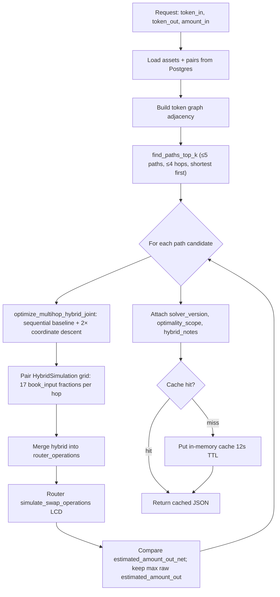

# Route solver — in-depth guide

## Route launch guards (#1390)

Logical routes visit the first offer and each ask once. Repeated route-tax-capable
assets are rejected by execute, forward/reverse quotes, solver and client
preflight even with zero rates, disabled guards or an exempt manager. Ordinary
intermediate buy/sell remains valid; independent routes keep per-wallet cooldown.
Only authenticated original-input residue restored to its payer can bypass
max-wallet. Bought output, intermediate residue and other recipients remain
capped. Protocol-exempt routed traders are rejected in previews and execution.
See [LG1390 invariants](../skills/AGENTS_ROUTE_LAUNCH_GUARDS.md) and
[agent review/verification checklist](qa/issue-1390/README.md).


## Route-local tax funding (#1381)

Funding version **1** follows [RT1381-1–RT1381-10](../skills/AGENTS_ROUTE_LOCAL_TAX.md)
and the [protocol/migration runbook](./runbooks/route-local-tax-1381.md).
Router input is a gross budget; taxes consume only this route's funds, pair credit
matches the declared economic hook amount, and pair→router buys are charged once.
Supported taxed intermediates remain eligible with net executable ranking. Older
T592-13/R607/R615 wallet-extra-debit, raw-output and middle-hop exclusion descriptions
in the historical sections below describe legacy deployments only. They are
superseded for v1; direct-pair Sell/SendFrom compatibility remains unchanged.
[QA evidence and agent checklist](./qa/issue-1381/README.md); `make verify-issue-1381`.

Authoritative reference for contributors and integrators using **`GET` / `POST /api/v1/route/solve`**. The solver is **advisory**: on-chain **`max_spread`** / **`min_receive`** at execute time are authoritative. This document expands [ADR 0002](./adr/0002-global-best-execution-route-solver.md) (decision record) without changing its decisions.

Pair-direct integrators use this same best-execution API: optimized GET requires `amount_in`, and a one-hop pair-direct call must execute with that hop's returned `hybrid` params; omitting hybrid on a direct pair swap remains pool-only under the current contract ([I707 guide](./integrators.md#pair-swap-pool-only-vs-best-execution-forgejo-707)).

**Related:** [indexer-invariants.md](./indexer-invariants.md) (HTTP matrix), [integrators.md](./integrators.md#route-discovery-and-quotes-l8), [skills/AGENTS_INDEXER_HYBRID_BEST_EXECUTION.md](../skills/AGENTS_INDEXER_HYBRID_BEST_EXECUTION.md).

**F6 freeze:** `find_path` / `build_adjacency` skip frozen hops (`code_id_frozen` cache). A frozen-only market returns **404**. See [indexer-invariants.md](./indexer-invariants.md) GitLab **#585**.

---

## Glossary

| Term | Meaning | JSON / code |
|------|---------|-------------|
| **Token graph** | Undirected graph: nodes = indexed CW20 assets (`assets.contract_address`); edges = indexed pairs (`pairs`). Native-only assets without a contract address are **not** routable (`token_in=uluna` → **400**). Retail Swap wrap-maps `uluna`→cLUNC / `uusd`→cUSTC **on the client** before GET ([#1218](https://git.cl8y.com/code/cl8y-dex-terraclassic/issues/1218)). | Built in `route_solver.rs` / `route_paths.rs` from Postgres |
| **Hop** | One swap leg: a pair contract, an **offer** CW20, and an **ask** CW20. | `hops[]`: `{ pair, offer_token, ask_token }` |
| **Path** | A simple (no repeated asset) sequence of hops from `token_in` to `token_out`. | `intermediate_tokens`: `[token_in, …, token_out]` |
| **Pool-only leg** | Constant-product AMM only; router op has `terra_swap.hybrid: null` (on-chain this is pool-only hybrid with `book_input = 0`). | `quote_kind`: `indexer_pool_lcd` or `indexer_route_only` |
| **Hybrid leg** | Split between pool and limit book: `pool_input + book_input = offer` for that hop. Retail **GET** attaches this only on **hop 0**; hops 1+ stay `hybrid: null` ([#1280](https://git.cl8y.com/code/cl8y-dex-terraclassic/issues/1280)). | `router_operations[].terra_swap.hybrid` |
| **`book_input` / `pool_input`** | Raw integer strings: offer amount routed to the limit book vs the AMM pool on one hop. | `HybridHopJson` in POST body / merged ops |
| **`book_start_hint`** | Optional order id to start the book walk on the **matcher side** for that hop (bid hint when offering token0, ask hint when offering token1). The global optimizer (`global_v2`) sets this to the first **live** resting order on that side when the Postgres mirror is fresh and `book_input > 0`; stale/missing mirror or pool-only hops leave it `null` ([#332](https://gitlab.com/PlasticDigits/cl8y-dex-terraclassic/-/work_items/332), [#289](https://gitlab.com/PlasticDigits/cl8y-dex-terraclassic/-/work_items/289)). Same hint is used in mirror/LCD `HybridSimulation` grid evals and in returned `router_operations`. Wrong-side hints are omitted server-side; on-chain validation (**L17**, [#272](https://gitlab.com/PlasticDigits/cl8y-dex-terraclassic/-/issues/272)) remains authoritative at execute time. | `HybridHopJson.book_start_hint` |
| **`RouteQuoteKind`** | How the quote was produced. | `quote_kind` (snake_case enum) |
| **`indexer_route_only`** | Topology only — no `estimated_amount_out` (missing `ROUTER_ADDRESS` and/or `amount_in`, or sim failed). | `RouteQuoteKind::IndexerRouteOnly` |
| **`indexer_pool_lcd`** | Pool-only router ops; LCD `simulate_swap_operations` when configured. | |
| **`indexer_hybrid_lcd`** | At least one hop has a non-zero book leg after optimization. | |
| **`indexer_hybrid_lcd_degraded`** | Hybrid grid failed on at least one hop; fell back to pool-only `HybridSimulation` (`book_input: 0`). | `OptimizationMeta.degraded` |
| **`solver_version`** | Solver generation label on global best-execution GET responses. **`global_v1`** (LCD grid) or **`global_v2`** (Postgres mirror grid when `ROUTE_SOLVER_DB_HYBRID=1`). | `best_execution::SOLVER_VERSION_LCD` / `SOLVER_VERSION_DB` |
| **`optimality_scope`** | Human-readable bound on what was searched — **not** a guarantee of global optimum over all paths or splits. | `best_execution::OPTIMALITY_SCOPE` |
| **`hybrid_notes`** | Model limits, degradation, and liability boundary for clients. | Built in `hybrid_notes_for_global` |
| **Degraded hybrid** | Per-hop: all 17 grid `HybridSimulation` candidates failed; solver uses pool-only fallback for that hop. | `quote_kind` → `indexer_hybrid_lcd_degraded` |

---

## Pipeline (global best execution)

Applies when **`GET /api/v1/route/solve`** (or **`/best`**) is called with **`amount_in`** set and **`pool_only` is not true**.



**Discovery-only GET** (no `amount_in`, or `pool_only=true`): **first** BFS shortest path only — no top-K enumeration, no hybrid optimizer. POST always uses first BFS path (max **4** hops) plus optional client `hybrid_by_hop`.

### Code map

| Stage | Module | Function / constant |
|-------|--------|-------------------|
| Graph + BFS (legacy) | `route_solver.rs` | `find_path`, `resolve_route_with_max_hops` |
| Top-K paths | `route_paths.rs` | `find_paths_top_k`, `PATH_ENUM_POOL` (= 32) then `select_usable_top_k` → `MAX_PATH_CANDIDATES` (= 5 usable) |
| Global winner | `best_execution.rs` | `solve_global_best_execution` |
| Per-hop / joint hybrid | `hybrid_route_opt.rs` | `optimize_multihop_hybrid_joint`, `GRID_POINTS` (= 17), `COORDINATE_PASSES` (= 2) |
| Router sim | `route_solver.rs` | `maybe_simulate` |
| Response cache | `route_solver.rs` | `ROUTE_CACHE_TTL`, `ROUTE_CACHE_TTL_DISTANT`, `hybrid_cache_key` |
| Graph snapshot cache | `route_graph.rs` | `ROUTE_GRAPH_CACHE_TTL`, `get_route_graph_snapshot` |
| Solve progress poll | `route_solve_progress.rs` | `GET /api/v1/route/solve/progress` |

---

## API matrix: GET vs POST

| | **GET** (default) | **GET** `pool_only=true` | **GET** `/best` | **POST** |
|--|-------------------|--------------------------|-----------------|----------|
| **Hop cap** | 4 (hybrid) / 4 (discovery) | 4 | 4 | 4 |
| **Path selection** | Top-5 by hop count + max `estimated_amount_out` when `amount_in` set; else first BFS | First BFS | Same as GET + `amount_in` | First BFS only |
| **Hybrid splits** | Server optimizer; **retail emit hop 0 only** (#1280). Interior hops `hybrid: null` | None (`hybrid: null`) | Same as GET | Client `hybrid_by_hop` optional (interior allowed) |
| **`amount_in`** | Optional (required for optimization) | Optional | **Required** | Optional |
| **`solver_version`** | Present when optimized | Absent | Present | Absent |
| **`optimality_scope`** | Present when optimized | Absent | Present | Absent |
| **Max maker fills** | Query `max_maker_fills` (default **8**) | N/A | Same | Per-hop in `hybrid_by_hop` |
| **Fee tier** | Optional `trader` / `sender` | Same | Same | Body `trader` / `sender` |

**Escape hatches**

- **`pool_only=true`** or deprecated **`hybrid_optimize=false`**: skip global solver; pool-only ops; max **4** hops.
- **`hybrid_optimize=true`** without `amount_in` → **400**.
- Zero **`amount_in`** on optimized GET → **400**.

**Example (interpretation)**

```bash
curl -sS "http://127.0.0.1:3001/api/v1/route/solve?\
token_in=terra1...&token_out=terra1...&amount_in=1000000" | jq .
```

Read the response using this doc:

- **`hops`** / **`intermediate_tokens`** — chosen path (≤ 4 hops for optimized GET).
- **`router_operations`** — submit-ready `ExecuteSwapOperations` shape; inspect `terra_swap.hybrid` per hop.
- **`estimated_amount_out`** — LCD router sim snapshot (`raw_out`); **not** a guaranteed fill. Execute / `min_return` use this.
- **`estimated_amount_out_net`** — catalog buy-split net when `token_out` is a community-tax CW20 (GitLab **#615**). Same as raw when no buy tax. Swap/Trade You Receive uses net; do not put net in `min_return`.
- **`quote_kind`** — whether hybrid legs were used or degraded.
- **`optimality_scope`** — search bounds (see below); do not market as unbounded “best price”.
- **`hybrid_notes`** — repeats liability + path/sim counts.

---

## Shipped constants (verify on solver changes)

| Constant | Value | Location |
|----------|-------|----------|
| `SOLVER_VERSION_LCD` | `global_v3` | `best_execution.rs` |
| `SOLVER_VERSION_DB` | `global_v4` | `best_execution.rs` |
| `MAX_PATH_CANDIDATES` | 5 | `best_execution.rs` |
| `PATH_ENUM_POOL` | 32 | `best_execution.rs` (structural DFS before skip-unusable; #1218) |
| `SOLVE_CONCURRENCY` | 5 (bounded concurrent candidate eval; #324) | `best_execution.rs` |
| `GET_DEFAULT_MAX_HOPS` | 4 | `route_solver.rs` |
| `GET_POOL_ONLY_MAX_HOPS` | 4 | `route_solver.rs` |
| `GRID_POINTS` | 17 | `hybrid_route_opt.rs` |
| Coordinate descent passes | 2 | `hybrid_route_opt.rs` (`COORDINATE_PASSES`) |
| Default `max_maker_fills` | 8 | `route_solver.rs` |
| `MAX_MAKER_FILLS_HARD_CAP` | **100** (on-chain parity; clamps GET query and DB sim — [#379](https://gitlab.com/PlasticDigits/cl8y-dex-terraclassic/-/issues/379)) | [`constants.rs`](../indexer/src/constants.rs), `dex-common/pair.rs` |
| `ROUTE_SOLVE_POST_BODY_LIMIT` | 128 KiB | `api/mod.rs` |
| `ROUTE_CACHE_TTL` | 12 s (1-hop direct) | `route_solver.rs` |
| `ROUTE_CACHE_TTL_DISTANT` | 90 s (multi-hop, ≥2 legs) | `route_solver.rs` |
| `ROUTE_GRAPH_CACHE_TTL` | 15 s | `route_graph.rs` |
| `ROUTE_CACHE_MAX_ENTRIES` | 512 | `route_solver.rs` |
| `AMOUNT_CACHE_BUCKET` | 1_000_000 (raw offer units) | `route_solver.rs` |

**#1257:** Bucket is **raw** offer units, not human tokens. 1 USTR (`10^18`) and 10000 USTR do not share a bucket; 1 USTR does not alias 1 UST1 (`10^6`). Cache key also includes `token_in` / `token_out`. Mixed 18/6 hops use wide `k`; implausible scale-mismatch drains skip the path ([`db_orderbook_sim.rs`](../indexer/src/api/db_orderbook_sim.rs)).
| `LCD_HYBRID_SIM_BUDGET` | 1700 (= 5×4×85) | `best_execution.rs` |
| `OPTIMALITY_SCOPE` | See [optimality scope](#optimality-scope-string) | `best_execution.rs` |

Cache key components: `solver_version`, `token_in`, `token_out`, **bucketed** `amount_in`, **bucketed** `max_maker_fills` (retail 1–8 → 8; 9–16 → 16; 17–30 → 30; above → **100** cap bucket; see `cache_key_maker_fills`), **`discount_bps`** from resolved tier ([#283](https://gitlab.com/PlasticDigits/cl8y-dex-terraclassic/-/issues/283), [#324](https://gitlab.com/PlasticDigits/cl8y-dex-terraclassic/-/issues/324)), **tax identity** (`buy`/`sell` bps + router-hops-tax flag + exempt bit — [#615](https://gitlab.com/PlasticDigits/cl8y-dex-terraclassic/-/issues/615)). Trader address is **not** keyed — same-tier / same-tax-identity wallets share cache. Ordinary CW20 identity is `none`.

**`max_maker_fills` cap (GitLab #379 / #262):** GET `max_maker_fills` is clamped to **`MAX_MAKER_FILLS_HARD_CAP` = 100**, matching on-chain `dex-common::pair`. The prior indexer DB-sim cap of **30** was stale. LocalTerra route-solve latency at cap **100** remains within the **30s** API timeout under typical book depth (same bound as chain execute); abuse requests like `max_maker_fills=4294967295` are clamped before hybrid grid / LCD fanout.

**Rate limits:** `route/solve`, `route/solve/best`, and **`route/solve/progress`** are LCD-heavy (**10 RPS** default per IP via `RATE_LIMIT_LCD_HEAVY_RPS`; prod clamps `0` → **10** — [#363](https://gitlab.com/PlasticDigits/cl8y-dex-terraclassic/-/work_items/363), [#694](https://gitlab.com/PlasticDigits/cl8y-dex-terraclassic/-/issues/694)). Startup **warns** when **both** `RATE_LIMIT_RPS` and `RATE_LIMIT_LCD_HEAVY_RPS` are explicitly **0** ([#379](https://gitlab.com/PlasticDigits/cl8y-dex-terraclassic/-/issues/379)). Sustained burst → **429** (plain text + optional rate-limit headers). LCD upstream failures → **502** `Upstream LCD query failed` (sanitized). `POST /route/solve` bodies larger than **128 KiB** → **413**.

### Progress poll (`GET /api/v1/route/solve/progress`) — GitLab #485

Advisory UI polling while a hybrid solve runs. **Not** a quote — no `estimated_amount_out`. Uses the **same query params** as `GET /api/v1/route/solve` (`token_in`, `token_out`, `amount_in` required, optional `trader`, `sender`, `max_maker_fills`). Optional progress-only **`discount_bps`** skips LCD `GetDiscount` when the client already resolved the wallet discount ([#694](https://gitlab.com/PlasticDigits/cl8y-dex-terraclassic/-/issues/694)). Progress key matches the hybrid response cache key (solver version + tokens + bucketed amount + maker-fills bucket + `discount_bps`).

Registered on **`lcd_heavy_router`** (same **10 RPS** as `/route/solve`). `GetDiscount` is cached **12s** per `(trader, sender)` so a 1 Hz poll does not LCD every tick. Progress still does not run hybrid grids.

| Field | Meaning |
|-------|---------|
| `stage` | `idle`, `graph_load`, `enumerating`, `loading_mirrors`, `evaluating`, `simulating`, `enriching`, `done`, `cached`, `error` |
| `done` / `total` | Honest counters during mirror preload (pairs) and path evaluation |
| `label` | Human-readable status (e.g. `Searching 2 of 5 paths…`) |
| `cache_hit` | `true` when the solve served a cached hybrid body |
| `updated_at_ms` | Unix epoch ms of last update |

Before a solve starts for the key, the endpoint returns `{ "stage": "idle", "label": "Waiting…", … }`. Nested slippage price solves (token valuation) do **not** update progress.

---

## Optimality scope string

The API returns exactly (from `best_execution::OPTIMALITY_SCOPE`):

> optimal within top-5 usable simple paths (skip ~100% hop-spread / hop_sim_implausible while filling K, hop-count order) and per-hop hybrid split grid (17 book fractions), with 2-pass coordinate refinement across hops

This means:

1. Only up to **five usable** simple paths are considered, preferring **fewer hops** (then lexicographic pair order). While filling K, skip ~100% hop-spread / `hop_sim_implausible` candidates so a thin 2-hop cannot occupy the slot an honest 3-hop would have scored ([#1218](https://git.cl8y.com/code/cl8y-dex-terraclassic/issues/1218)). Structural DFS enumerates up to `PATH_ENUM_POOL` (32); hybrid eval stays `MAX_PATH_CANDIDATES` (5). Do **not** bump K as the primary fix.
2. On each path, each hop’s `book_input` is chosen from a **17-point** uniform grid on `[0, offer_amount]`, plus **two** full coordinate-descent passes that re-optimize each hop given the current plan.
3. **Retail emit (#1280):** after ranking, declared `hybrid` is kept on **hop 0 only**; hops 1+ are `hybrid: null` so execute `hop_output` cannot miss a frozen interior split. `estimated_amount_out` is simulated on those emitted ops. Under `ROUTE_SOLVER_DB_HYBRID=1`, `fidelity_check` DB-sims the **stripped** plan (`propagate_offer_through_plan`) against that LCD sim — not the unstripped joint `grid_out`. `POST hybrid_by_hop` is unchanged.
3. The winning path is the one with highest **`estimated_amount_out_net`** (catalog buy/sell policy for this snapshot — GitLab **#615**). `estimated_amount_out` stays the hop/router **`raw_out`**. Ties: first path with that net wins (later equal paths do not replace). Option-2 wasm: a path that sells a catalogued tax token as a **middle** hop is skipped. Unmigrated **11611** does not skip.

Paths **outside** the top-5 shortest (by hop count) are never evaluated. Split points **between** grid nodes are not exhaustively searched. The solver is **not** MEV-aware and uses an **LCD snapshot** that can change before execute.

---

## Non-goals

| Not guaranteed | Why |
|----------------|-----|
| Global optimum over **all** simple paths | Only top-5 **usable** by hop count (`MAX_PATH_CANDIDATES`) after skip-unusable fill (`PATH_ENUM_POOL`) |
| Optimal split between grid points | 17-point grid + 2 CD passes — not continuous convex search |
| Same quote as execute after mempool / block delay | Snapshot LCD + resting book state |
| MEV / sandwich protection | Advisory quoting only |
| POST path optimality | POST uses first BFS path; client owns `hybrid_by_hop` |
| Discovery GET without `amount_in` | Single BFS path, no comparison |

Clients **must** set on-chain **`max_spread`** / **`min_receive`** (or equivalent) at execution.

---

## Remaining failures census (docs-only)

Retail quote skips / timeouts / disagreements with optimized GET are catalogued in [ADR 0007](./adr/0007-route-solve-remaining-failures.md) (closed [#1265](https://git.cl8y.com/code/cl8y-dex-terraclassic/issues/1265), implemented by [PR #1289](https://git.cl8y.com/code/cl8y-dex-terraclassic/pulls/1289)). The accepted memo does **not** change shipped constants below; wallet simulation remains explicitly unmeasured. Native wrap mapping / solver execution landed under [#1218](https://git.cl8y.com/code/cl8y-dex-terraclassic/issues/1218) / PR #1297; raw native GET IDs remain invalid by design. Newer pre-sign route-display work is [#1330](https://git.cl8y.com/code/cl8y-dex-terraclassic/issues/1330); mixed 18/6 honesty was resolved under closed [#1257](https://git.cl8y.com/code/cl8y-dex-terraclassic/issues/1257). Verify: `make verify-issue-1265`.

---

## Optimization theory (shipped heuristics ↔ literature)

References are **explanatory** — they do not imply the implementation is provably optimal.

### 1. Top-K simple paths by hop count

| Shipped | `route_paths::find_paths_top_k` with `PATH_ENUM_POOL = 32`, then `select_usable_top_k` → `MAX_PATH_CANDIDATES = 5`, iterative deepening shortest-first |
| Research | **Yen (1971)** — algorithm for K shortest simple paths; **Eppstein (1998)** — efficient K shortest paths in graphs |
| Relevance | CL8Y caps K and orders by hop count (fee/slippage priority) rather than implementing full Yen; pruning uses BFS distance-to-goal (#286) for O(V+E) soundness |

### 2. Constrained routing (hop cap, asset continuity)

| Shipped | `max_hops` = 4 (hybrid GET / pool-only / POST); simple paths only; CW20 continuity enforced per hop |
| Research | **Resource-constrained shortest path** (OR / networks); **label-setting** multicommodity routing |
| Relevance | Hop cap matches router `MAX_HOPS`; path must be simple to avoid token cycles |

### 3. Per-hop hybrid split grid

| Shipped | `optimize_one_hop`: 17 uniform `book_input` fractions; maximize pair `HybridSimulation` `return_amount` |
| Research | **Univariate grid search** / **golden-section** on unimodal functions; **coordinate descent** when multiple hops coupled |
| Relevance | Book+pool output is queried via LCD, not a closed form — grid is a practical heuristic |

**Empty-book short-circuit (GitLab [#493](https://gitlab.com/PlasticDigits/cl8y-dex-terraclassic/-/issues/493)):** Under `global_v4`, when a hop’s Postgres mirror is **Fresh** and has **no fillable resting orders** on the taker match side (`mirror_has_fillable_book` / `first_live_book_start_hint`), the hop prices **pool-only once** and skips the 17-point grid. This does **not** shrink optimality: with an empty match-side book every `book_input > 0` split equals pool-only (unconsumed book input spills to the pool). Stale/missing mirrors and `global_v3` (LCD) keep the full grid. Live-book hops still run all 17 fractions — no `solver_version` bump.

### 4. Joint multihop refinement

| Shipped | `optimize_multihop_hybrid_joint`: sequential baseline, then **2** passes optimizing each hop with `propagate_offer_through_plan` |
| Research | **Block coordinate descent** (e.g. Wright 2015 survey); **alternating optimization** for coupled nonlinear objectives |
| Relevance | Hop outputs feed next hop’s offer; CD re-opens earlier hops after downstream splits change |

**1-hop pool-only skip (#493):** After the sequential baseline, if the path is **1 hop** and the plan is pool-only (`hybrid: null` / `book_input = 0`), coordinate descent is skipped — it would re-run the same split search with the same offer. Multihop paths still run both CD passes.

### 5. Pool leg simulation / liquidity-weighted routing

| Shipped | Pool leg via on-chain `HybridSimulation` / constant-product pair math inside the contract |
| Research | **Danos & Willinger (2010)** — network flow view of DeFi; **Balancer** smart-order routing / path algorithms (liquidity-weighted multihop) |
| Relevance | CL8Y does not precompute edge weights offline — each candidate path is scored by live LCD sim |

### 6. Hybrid AMM + limit book

| Shipped | Per-hop `pool_input` / `book_input` split; `max_maker_fills` caps book matches |
| Research | **Market microstructure** — price impact across lit pool vs resting liquidity; **smart order routing** splitting across venues |
| Relevance | Limit book is discrete price levels; `max_maker_fills` bounds walk depth |

### LCD query budget

Documented upper bound: `LCD_HYBRID_SIM_BUDGET = MAX_PATH_CANDIDATES × GET_DEFAULT_MAX_HOPS × (17 + 2×2×17) = **1700**` pair-level simulations per request (worst-case estimate). Post-#319 each hop is priced from the DB orderbook mirror rather than live LCD; `lcd_hybrid_queries` is an approximate running count during evaluation. Empty-book short-circuit (#493) lowers **typical** `db_hybrid_queries` for empty match-side books; the **1700** figure remains the worst-case upper bound when every hop has a live book.

---

## Future work (not shipped)

| Upgrade | When to consider | Cost driver |
|---------|------------------|-------------|
| Increase K (`MAX_PATH_CANDIDATES`) | More pairs, frequent longer-cheaper paths — prefer skip-unusable fill first ([#1218](https://git.cl8y.com/code/cl8y-dex-terraclassic/issues/1218)) | LCD calls × paths |
| Finer grid / adaptive search | Large trades where grid misses interior optimum | LCD per hop |
| Edge-weight pruning before top-K | Very dense graphs | Engineering complexity vs #286 gate |
| Yen / Eppstein full K-shortest | Need provable K-shortest without hop-first bias | CPU + LCD |
| MEV-aware routing | Not planned for advisory indexer | N/A |

Tie changes to **`LCD_HYBRID_SIM_BUDGET`**, **`RATE_LIMIT_LCD_HEAVY_RPS`**, and operator LCD capacity.

---

## Abuse / integrator pitfalls

| Vector | Mitigation |
|--------|------------|
| Treating quote as guaranteed fill | Doc + `hybrid_notes` state snapshot / advisory nature |
| Cache poisoning across tiers | Cache keys include `discount_tier` ([#283](https://gitlab.com/PlasticDigits/cl8y-dex-terraclassic/-/issues/283)) |
| Path explosion DoS | Server caps paths, hops, LCD budget; reachability gate O(V+E) ([#286](https://gitlab.com/PlasticDigits/cl8y-dex-terraclassic/-/issues/286)) |
| Micro-amount cache busting | Amount bucketing (`AMOUNT_CACHE_BUCKET`); avoid hammering unique tiny amounts |
| Mixed-dec 18→6 theater quotes (#1257) | Wide `k` + implausible hop skip; cache keys include tokens + raw bucket |
| “Best execution” marketing | Read `optimality_scope` bounds |

---

## Frontend cross-link

The retail dApp consumes indexer routes for swap preview; sequential pair-level preflight still enforces **`max_spread`** per hop because router sim does not return per-hop spread. See [swap-max-spread-ux.md](./swap-max-spread-ux.md), [frontend.md § Swap](./frontend.md#swap-page-integration), [frontend.md § USTR/USDT quote scale](./frontend.md#ustr-usdt-quote-scale), [skills/AGENTS_FRONTEND_SWAP_ROUTE_DISPLAY.md](../skills/AGENTS_FRONTEND_SWAP_ROUTE_DISPLAY.md), [skills/AGENTS_FRONTEND_SWAP_USTR_USDT_SCALE.md](../skills/AGENTS_FRONTEND_SWAP_USTR_USDT_SCALE.md).

---

## Drift guard

When changing solver constants, run:

```bash
python3 scripts/check_route_solver_docs.py
```

This checks that `docs/route-solver.md` and `OPTIMALITY_SCOPE` / key constants in Rust stay aligned.

## Exact-output sizing

[#1376](https://git.cl8y.com/code/cl8y-dex-terraclassic/issues/1376) adds `GET /api/v1/route/solve?token_in=...&token_out=...&amount_out=<raw-net-target>`. Existing `amount_in` requests retain their API. `amount_out` must be a positive ASCII Uint128 integer (at most 39 digits); input/output modes, `hybrid_optimize=true` and `pool_only=false` conflict and return 400. POST output targets are explicitly rejected. Native denoms remain client-mapped to CW20s.

The sizing engine in [`route_exact_output.rs`](../indexer/src/api/route_exact_output.rs) uses exact checked integer pool inverses on fresh indexed reserves. It considers up to 32 structural simple paths ordered by hop count, at most four hops, and compares the first five feasible fresh candidates. Every leg is pool-only. It excludes hybrid books and unsupported option-2 taxed middle hops rather than assuming book/split optimizers are monotonic. Thus it finds a minimum within the published pool candidate/snapshot scope, not an unrestricted best price. An unusable path may be skipped in favor of an eligible alternative.

Discount context follows the existing trader/sender policy. Final buy-tax inverses size a net target; `estimated_amount_out` remains the pre-tax minimum basis and `estimated_amount_out_net` is the display/target basis. The client handles mapper native gross-ups and extra-debit sell balances, then repeats authoritative wallet forward validation on the exact selected operations. If a tax model or current forward quote cannot substantiate sufficient net output, sizing fails closed.

Responses add `required_amount_in`, `target_amount_out`, `sizing_mode="pool_only_exact_output"`, `snapshot_age_ms`, and `snapshot_block_height` to the existing route response. They include operations, quote kind, solver version `pool_exact_output_v1`, fidelity and `optimality_scope`. A fresh router forward query must cover the requested net target and pass the configured mirror/LCD drift tolerance. Stale or infeasible snapshots never produce a topology-only success for receive sizing.

There is no executable exact-output response cache, so targets and contexts cannot collide through amount buckets. Work is bounded to four concurrent requests with one active request per socket-peer IP (shared across both GET endpoints), a 20-second total budget, at most five router validations (three seconds each), up to 20 pair pause probes and five factory blacklist probes (one second each), plus shared fee/exemption context resolution. Graphs are capped at 8,192 pairs. Sizing and the two fair-reference searches each allow at most 100,000 DFS edge visits (300,000 total). Reserve-only preload is bounded to 128 sizing pairs plus up to 256 reference pairs (384 total); it does not load unused resting books. Snapshot age is checked again before validation. Cancellation drops the request future and semaphore permit; discovery work is separately bounded. HTTP 404 indicates no path, 422 an infeasible/stale/unsupported target or nonwaivable ≥99% fair-rate rejection, 429 busy capacity, 503 missing router validation or required fair reference, and 504 timeout. Applications must show finite errors and offer manual retry; do not repeatedly call the expensive offer-in solver to approximate exact-output.

The fair-reference engine in [`route_exact_output_reference.rs`](../indexer/src/api/route_exact_output_reference.rs) prices one whole input/output token against the preferred wrapped USTC/LUNC quote asset using the same bounded pool-only path scope and fee context. If no standard quote asset exists, the input token is the local reference. A present but ambiguous or unreachable standard quote fails closed. Strict tax catalog loading includes reference intermediaries; unsupported taxed middle hops are excluded. Reference-only paths are advisory fresh reserve arithmetic with metadata/gem/freeze filters; they receive no additional live pause/blacklist probes. Actual execution candidates still receive those live guards. This is a bounded pool reference, not unrestricted hybrid-book valuation.

`spot_amount_out` and `slippage_percent` are mandatory positive-reference fields on successful exact-output responses. Cross-rate products, decimal scaling, rounding and symmetric deviation use checked integer arithmetic. Server selection rejects ≥99% deviation and may try an alternate; lower deviations preserve the existing 5/30 consent and Expert behavior. The frontend requires the reference, recomputes deviation against fresh wallet output and rechecks spread/slippage at mutation entry. Missing/stale/unrepresentable references never silently remove these protections.

Execution remains an offer-in transaction protected by existing spread and minimum-receive semantics. A successful sizing quote is not a guarantee against changes between quote and inclusion. Review [E1376 invariants](frontend.md#solver-receive-sizing), [agent protocol](../skills/AGENTS_SWAP_EXACT_OUTPUT.md), and [the verification/migration checklist](qa/issue-1376/README.md).

## Reverse-query availability (#1389)

Issue [#1389](https://git.cl8y.com/code/cl8y-dex-terraclassic/issues/1389),
[agent protocol](../skills/AGENTS_REVERSE_QUERY_BUDGET.md),
[review and gas evidence](qa/issue-1389/README.md).

| Invariant | Contract |
| --- | --- |
| **RQ1389-1** Shared request budget | Router reverse reserves at most **33 pair simulations per hop** and **96 per request**, including one fresh forward simulation per hop, for up to four hops. Denial occurs before a nested call. Failed attempts consume cost. |
| **RQ1389-2** Opaque nested work | A declared reverse with nonzero book input reserves the pair's full **32** internal forward-call ceiling; Pool reverse and greedy pool seeds cost one only for raw cw2 identities `cl8y-dex-pair` exactly `1.19.0`/`1.20.0`; legacy, missing, malformed, failed or unknown identity reserves 32. Future versions receive no inferred discount. Counting outer smart queries alone understates declared work. Three/four declared book hops can be denied even when each pair search would finish early; four cheap pool/greedy hops remain supported. |
| **RQ1389-3** Cache and safe probes | Greedy repeated offers reuse request-local output. Checked pool inverse seeds and declared interpolation propose probes only. Pair declared search retains its 32-call ceiling and cached sufficient result; a claimed minimum requires an adjacent insufficient offer. No seed fallback can evade accounting. |
| **RQ1389-4** Protected sufficiency | The final fresh forward route must cover the original target using the same trader/sender, tax flow and declared ratio template. Seed/rounding failure, `REVERSE_QUERY_BUDGET_EXCEEDED`, `REVERSE_TARGET_INFEASIBLE` and `REVERSE_FORWARD_INSUFFICIENT` produce errors rather than executable guesses. Query errors keep the existing JSON ABI and expose stable discriminators in their error strings. |
| **RQ1389-5** Fair admission | Both exact-output GET endpoints share four global slots and one active request per socket-peer IP, with no waiting queue. IPv4-mapped IPv6 is normalized. Forwarded headers and trader/sender never supply the key. Missing peer metadata shares one conservative bucket. Proxies/NAT share the socket peer's bucket; trusted proxy identity requires a separate vetted policy. |
| **RQ1389-6** Cleanup and metrics | Admission state contains at most four active client keys and retains none when idle. RAII releases on cancellation, error or the existing 20-second timeout. Aggregate `exact_output_capacity` tracing counters cover admission, client/global rejection, completion, failure, timeout, cancellation and active count without client labels. |
| **RQ1389-7** Observe and intent | Observe uses checked block-time subtraction and rejects invalid horizons without panic. Receive quote errors preserve typed intent, invalidate executable Pay/operations, stop deterministic automatic retries and do not resend or weaken signing protection. |
| **RQ1389-8** Evidence scope | Count simulations using synthetic fixtures; measure gas only on isolated LocalTerra. Executed failures remain FAIL, unavailable checks remain SKIP and overall implementation review may PASS with explicit skips. Test success never proves production migration/deployment. |

The limits bound nested pair simulation work rather than promising a gas ceiling
for arbitrary state. Each hybrid walk retains **100 maker fills** and **500 scan
steps**. Factory lookups are bounded to two per hop, plus one raw pair cw2 identity read; route-tax capability/preview
work has no search loop (at most 20 token queries per ordinary-token hop including
raw cw2 fallback, or nine for route-funded tax tokens). Pair-local storage and
discount/book checks still consume gas. Conservative opaque reservations and
large active-book integer plateaus may reject otherwise feasible quotes; never
raise caps or auto-submit a weaker trade to avoid this error. Greedy targets that
the pool seed cannot represent remain unsupported even if book-only liquidity
might cover them. Use manual retry after context/state changes.

Pair cw2 **1.20.0** and router cw2 **1.3.0** identify this query repair. Storage
and execute messages are unchanged. Existing deployments need the matching
artifacts migrated and the factory pair-code pointer updated before these
direct-LCD bounds apply. This PR supplies implementation and test evidence;
production pair rollout remains separately tracked by
[#1386](https://git.cl8y.com/code/cl8y-dex-terraclassic/issues/1386).

## Funded trading capability and quote identity (#1381)

`TRADING_TAX_FREE_CODE_IDS` registers reviewed ordinary CW20 implementations.
`TRADING_ROUTE_TAX_CODE_IDS` / `TRADING_ROUTE_TAX_DATA_HASHES` register reviewed
funding-v1 community-tax implementations. These trading registrations do not
alter `COMMUNITY_TAX_CODE_ID`, launcher/admin provenance or Create/Manage catalog
attestation. Set the ordinary local mintable and newly stored supported token
codes in LocalTerra; deployments must use actual stored immutable code identities.

Discovery resolves candidate instance/code/hash and live capability/router/rates,
including ALPHA absent from the catalog. Unknown, untrusted, legacy or failed
capabilities are unavailable for execution. Per-token manager/directory exemptions
are independent; an exemption on ALPHA cannot waive another token's tax. Limits:
64 candidate assets, four global concurrent discovery calls, three-second query
budget, five-second bounded cache, 512 entries. Cache identities include the LCD
client/chain deployment, router, policy and all observed candidate asset versions,
rates and exemption state; invalidate/restart caches during migrations.

Funded GET/POST, exact-output and progress responses identify `tax_kind=route_local_v1`.
Both `estimated_amount_out` and `estimated_amount_out_net` are already net. The
router's funded simulation is the final quote authority; a DB hybrid plan must
size its book/pool allocation using the funded economic input and each next hop's
post-buy net budget. Exact-output returns a sufficient gross input and validates
it through forward quoting. Preserve the existing hop0-only Policy A and route
caps. Client fallback requires live compatible funding and cannot restore a
wallet-funded intermediate route. [RT1381 invariants](../skills/AGENTS_ROUTE_LOCAL_TAX.md)
and [agent checks](qa/issue-1381/README.md) govern all these paths.

### Deterministic route preview rejection (#1390)

Forward GET/POST and exact-output solves return HTTP 422 with
`router_preview_rejected` when fresh router simulation reports a contract
validation rejection. The response omits raw LCD details and wallet addresses.
Best execution may use another valid candidate; if no candidate succeeds it
preserves the explicit rejection. A protocol-exempt routed trader is rejected
by token Sell/Buy previews. Current previews do not certify future cooldown,
trading-enabled or recipient max-wallet state; execution remains responsible
for those mutable launch controls. See [LG1390](../skills/AGENTS_ROUTE_LAUNCH_GUARDS.md).

Indexer GET/POST choose simple paths from endpoint tokens. POST only overrides
hybrid quantities on those hops; caller-selected asset paths/operations are not
API inputs. Amount-less responses are structural only. Executable amount quotes
use the same capable-token eligibility policy.

Router trust lifecycle (#1388): [RTTRUST1388-1–RTTRUST1388-10](../skills/AGENTS_ROUTER_TRUST_LIFECYCLE.md); [recovery and migration](runbooks/router-trust-1388.md); `make verify-issue-1388`.
