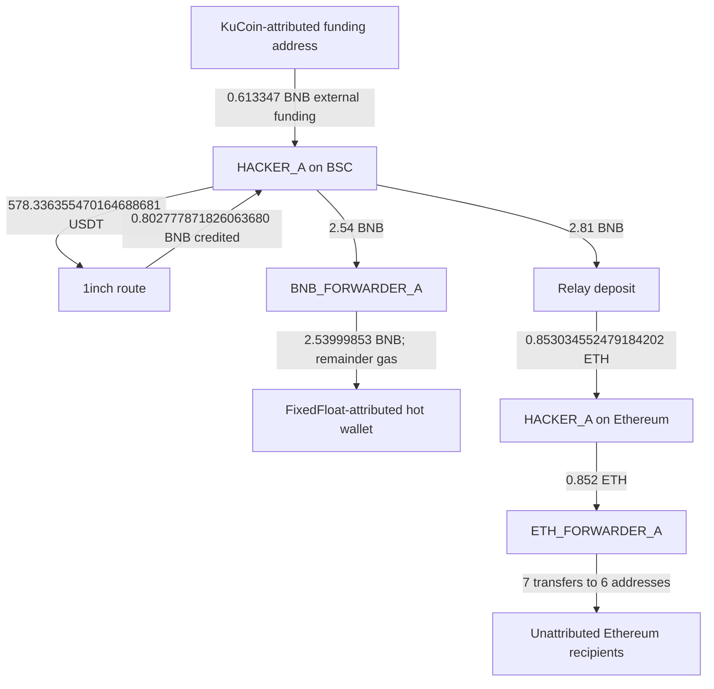

# BNB onward movements and Ethereum bridge follow-up

Collected on 16 October 2026 UTC. The newly reconstructed movements below occurred on **15 October 2026 UTC**, after the original report's BSC log cutoff of 09:12:20 and balance check at 09:44:22. This supplement supersedes any reading of those historical holdings as present balances. It preserves the original observations and dated USD valuation.

No software tests, test suites or CI checks were run for this documentation update. Hash manifests were regenerated as publication metadata. The operator explicitly requested a documentation-only merge with CI/tests skipped. No contract, application or CI policy source is changed.

## Address roles and attribution

| Label | Chain / address | Evidence and boundary |
| --- | --- | --- |
| `[HACKER_A]` | BSC and Ethereum: `0x46b2ebf5ec9bbbca91fb826a6c13aa7ccdb66f8d` | Existing incident address; the Ethereum address is the same 20-byte address, rather than a new identified person |
| `[BNB_FORWARDER_A]` | BSC: `0x516b518CeA9005225102F715E23EccA9E5ca7D16` | Received 2.54 BNB and forwarded it less gas. Whether this is an attacker-controlled wallet or service deposit address is unresolved |
| `[EXCHANGE_FIXEDFLOAT]` | BSC: `0x4727250679294802377dD6cA6541B8E459077c95` | Requester-reported FixedFloat hot wallet; supported by the same address's public Etherscan label. Attribution is external to consensus; it does not identify a customer/order or prove wrongdoing by FixedFloat |
| `[FUNDING_KUCOIN_28]` | BSC: `0x635308e731a878741bfec299e67f5fd28c7553d9` | Explorer-labelled KuCoin 28. The payment is proven; the underlying exchange customer and source of its funds are unknown |
| `[RELAY_DEPOSITORY]` | BSC: `0x4cd00e387622c35bddb9b4c962c136462338bc31` | Native deposit receipt plus the matching Relay request identifies the conversion route |
| `[ETH_FORWARDER_A]` | Ethereum: `0xcb49c4125db32522ba508362fdfba693e63dfc4b` | Received 0.852 ETH; seven subsequent native transfers are recorded below. Controller/service ownership is unassigned |

Public exchange/service labels do not make these services or their unrelated users attackers. Personal names, victim handles and interview details remain excluded.

## Flow overview



The arrows through the bridge are a conversion and linked settlement, not a direct same-chain transfer or additional gain. Native and wrapped/transit appearances must not be added together.

## BSC transactions and exact native accounting

| UTC | Action | Native value / result | Transaction |
| --- | --- | --- | --- |
| 13:32:09 | Approve 100 CL8Y to `0x84d88856a62ce42165d3f196124d5bd50f17c2bb` (no transfer) | 0 BNB | [0x0f36d3e62ef5c80903bfda297b0ffe0bb7046bef8a41f6b23d4119e0d9a1e9ab](https://bscscan.com/tx/0x0f36d3e62ef5c80903bfda297b0ffe0bb7046bef8a41f6b23d4119e0d9a1e9ab) |
| 13:41:29 | KuCoin-attributed external funding | 0.613347 BNB | [0x26b098e4a5b96d53563c901b38424705b5bfbd1bfb5ae7a5a26563f3484aaf44](https://bscscan.com/tx/0x26b098e4a5b96d53563c901b38424705b5bfbd1bfb5ae7a5a26563f3484aaf44) |
| 13:42:58 | Approve the 578.336355470164688681 USDT swap input | 0 BNB | [0x0dd84342a7ac65bc91684946c851947f3810fa7643b8a39bb5442886605683b3](https://bscscan.com/tx/0x0dd84342a7ac65bc91684946c851947f3810fa7643b8a39bb5442886605683b3) |
| 13:42:59 | 1inch USDT → native BNB swap | 0 outer BNB; 0.802777871826063680 BNB received | [0xf779fd4d623a6ba03ad16b0490e42b2df9d50fd2c3e1370242b17a239451fbca](https://bscscan.com/tx/0xf779fd4d623a6ba03ad16b0490e42b2df9d50fd2c3e1370242b17a239451fbca) |
| 13:45:48 | Relay native deposit | 2.81 BNB | [0xeec21b74576c017c504aadfd37112856fdd54e6c6a7db47bcdc84a94c65b38bc](https://bscscan.com/tx/0xeec21b74576c017c504aadfd37112856fdd54e6c6a7db47bcdc84a94c65b38bc) |
| 13:58:02 | Approve 200 CL8Y to `0xccc88a9d1b4ed6b0eaba998850414b24f1c315be` (no transfer) | 0 BNB | [0xbaf4c6e170a2bf03df228aec6a1b9324626d920ba5ccd33236a43adbd10e7ca0](https://bscscan.com/tx/0xbaf4c6e170a2bf03df228aec6a1b9324626d920ba5ccd33236a43adbd10e7ca0) |
| 14:10:23 | Pay `[BNB_FORWARDER_A]` | 2.54 BNB | [0xd956503b88fe9a54ee8c558262b25877c61c501b897c3ccab45486ac659ccf86](https://bscscan.com/tx/0xd956503b88fe9a54ee8c558262b25877c61c501b897c3ccab45486ac659ccf86) |
| 14:11:25 | Forward to FixedFloat-attributed hot wallet | 2.53999853 BNB | [0x84547676907c2806934d49ff2e9d9eb20c340430de1feee6fe3305ae32bda7f2](https://bscscan.com/tx/0x84547676907c2806934d49ff2e9d9eb20c340430de1feee6fe3305ae32bda7f2) |

All eight BSC receipts show successful inclusion. Six transactions are `[HACKER_A]` account nonces **56–61**, following the original nonces 0–55. The other two are the exchange-attributed funding payment and the forwarder's sole outgoing nonce 0.

The USDT receipt and native call tree establish:

- **578.336355470164688681 USDT** left `[HACKER_A]` for execution contract `0x111116058b9828cdcdd810c502b925c14f34ca11` through router `0x111111125421ca6dc452d289314280a0f8842a65`.
- **1.445840888675411721 USDT** went to routing-fee recipient `0xcd6b980029e6e6e0733ac8ec3e02be9410d09799`.
- **576.890514581489276960 USDT** reached pool `0xf3eb104c0773d79f69cabf1da938153ce0efafd6`.
- The route unwrapped WBNB internally and actually credited **0.802777871826063680 BNB** to `[HACKER_A]`. WBNB is transit, not another amount received by the wallet.

Exact BSC closure, in BNB:

```text
3.937299591343244805   original captured closing balance
+ 0.613347000000000000  later KuCoin-attributed external funding
+ 0.802777871826063680  USDT-sale native receipt
- 0.000026590207090000  gas for outgoing nonces 56–61
- 2.810000000000000000  Relay deposit
- 2.540000000000000000  payment to BNB_FORWARDER_A
= 0.003397872962218485  later captured HACKER_A balance
```

Forwarder closure:

```text
2.540000000000000000 - 2.539998530000000000 - 0.000001470000000000 = 0 BNB
```

The source paid 0.000001155 BNB gas to send the 2.54 BNB. The forwarder separately paid 0.00000147 BNB gas to forward 2.53999853 BNB. The latter gas must not be deducted twice from the exchange receipt.

At pinned BSC block **127899526**, `[HACKER_A]` had account nonce 62, **0.003397872962218485 BNB**, **0 USDT**, **0 WBNB**, and **25452.503948354102807429 CL8Y**. `[BNB_FORWARDER_A]` had nonce 1 and zero native balance. The CL8Y approvals changed allowances, not token holdings. These later observations do not independently attest that historical pause/block controls remain in force.

The 0.613347 BNB payment is **outside funding**, not additional proven theft. It was commingled with existing incident proceeds before both principal outflows. Public evidence does not uniquely allocate specific originating units between the 2.81 BNB bridge deposit, the 2.54 BNB forwarder payment, gas and retained balance. The exchange's underlying customer and any relation to the victim are unestablished.

## Relay conversion and Ethereum continuation

The BSC deposit is `depositNative(address,bytes32)`, selector `0x49290c1c`. Its receipt records depositor `[HACKER_A]`, amount **2810000000000000000 wei**, and protocol order ID:

`0xf5516fecee51cf9b97f4ee6b2c239710bf71c67045d3dea0b1711ad47f3a0cdf`

Relay's exact origin-hash lookup returns request ID:

`0x1792071939507ab5bc9fbeb7b37d73dcbeccc1704312408cbca0212cae847ebc`

The matching service record identifies BSC chain 56 → Ethereum chain 1, native BNB → native ETH. The order ID is distinct from the API request ID. The public v2 origin-hash query returned one matching record; the v3 endpoint required an API key. Unfiltered responses are excluded.

| UTC | Chain / movement | Amount | Transaction |
| --- | --- | --- | --- |
| 13:45:48 | BSC `[HACKER_A]` → Relay depository | 2.81 BNB | [0xeec21b74576c017c504aadfd37112856fdd54e6c6a7db47bcdc84a94c65b38bc](https://bscscan.com/tx/0xeec21b74576c017c504aadfd37112856fdd54e6c6a7db47bcdc84a94c65b38bc) |
| 13:45:59 | Ethereum `0x18dd3c14e34c1bc379f7538068c59160d9f68e25` → `[HACKER_A]` | 0.853034552479184202 ETH | [0xa18414194daf282989e360d41a20cd593e5688ca347f265ebd71a98c2282776c](https://etherscan.io/tx/0xa18414194daf282989e360d41a20cd593e5688ca347f265ebd71a98c2282776c) |
| 13:46:35 | Ethereum `[HACKER_A]` → `[ETH_FORWARDER_A]` | 0.852 ETH | [0xd7340ff0c82a79d29b6fbea7b7dabaec4cbd49eeea367b8bc33245945540a4dc](https://etherscan.io/tx/0xd7340ff0c82a79d29b6fbea7b7dabaec4cbd49eeea367b8bc33245945540a4dc) |

The destination Ethereum receipt independently confirms the service-reported fill, including the matching order ID in its calldata. It is not based on a bridge API status alone. The subsequent sender nonce 0 paid **0.000022089702978 ETH** gas and left **0.001012462776206202 ETH** at `[HACKER_A]` in the later captured state:

`0.853034552479184202 - 0.852 - 0.000022089702978 = 0.001012462776206202 ETH`

The Ethereum forwarder's prior queried balance/nonce were zero. Its seven subsequent transactions, nonces 0–6, sent native ETH to six addresses:

| UTC | Recipient label / address | ETH value | Transaction |
| --- | --- | --- | --- |
| 14:06:11 | [ETH_RECIPIENT_6] `0x9dcb9783532e34f16c630036309cc90db06dbbd0` | 0.33975758296455479 | [0x5c4bba5ab26c2bd41907b5ec051cc6744989e1fd7aea06ed2645c638136c5eff](https://etherscan.io/tx/0x5c4bba5ab26c2bd41907b5ec051cc6744989e1fd7aea06ed2645c638136c5eff) |
| 14:33:47 | [ETH_RECIPIENT_1] `0x038b0ff3c37dd02bdd6823b31a368a8c06b95b3e` | 0.126584949049558007 | [0x3ee7c2d8ae372a0ea3f799e131c099af33130d98627a469d8306b0d1ca37ee95](https://etherscan.io/tx/0x3ee7c2d8ae372a0ea3f799e131c099af33130d98627a469d8306b0d1ca37ee95) |
| 15:54:35 | [ETH_RECIPIENT_4] `0x6a9811d000ca91d6a95a673604778677cdee8b00` | 0.012291606062220109 | [0x84196711c8b1254c85663aed2ced974c068563130ff25d2ddae1801283b6e613](https://etherscan.io/tx/0x84196711c8b1254c85663aed2ced974c068563130ff25d2ddae1801283b6e613) |
| 16:38:59 | [ETH_RECIPIENT_2] `0x1bbf9f501f715a8000d55842685836dac72f5b36` | 0.123537114667149834 | [0x6e3d5aeb58861e48dc28712c212d3f03900680c026dd4ed84069e53682e7da18](https://etherscan.io/tx/0x6e3d5aeb58861e48dc28712c212d3f03900680c026dd4ed84069e53682e7da18) |
| 16:51:11 | [ETH_RECIPIENT_4] `0x6a9811d000ca91d6a95a673604778677cdee8b00` | 0.024639544004172296 | [0x844ec503b29d20090d7c5c824f642d3c22eb48d366d0b643e082bbc751b74b46](https://etherscan.io/tx/0x844ec503b29d20090d7c5c824f642d3c22eb48d366d0b643e082bbc751b74b46) |
| 17:02:47 | [ETH_RECIPIENT_5] `0x96a81ec9e1dfd0ce7833da54ebdcd842ca6aa1f9` | 0.082117987123899618 | [0x08d2caed33399cd819fc05fd93d8bd689c7251c4df0c2185cbc2b9d45db17a93](https://etherscan.io/tx/0x08d2caed33399cd819fc05fd93d8bd689c7251c4df0c2185cbc2b9d45db17a93) |
| 17:19:35 | [ETH_RECIPIENT_3] `0x40b0869f2725b94058e939ec84d343c214a9c051` | 0.142875663523351347 | [0x05d9f7019061e02d0aafa45bd22cb795407c1489a2eb4e5a0536f00cd032ac30](https://etherscan.io/tx/0x05d9f7019061e02d0aafa45bd22cb795407c1489a2eb4e5a0536f00cd032ac30) |

These seven transfers total **0.851804447394906001 ETH**; their receipts report **0.000195552605094 ETH** gas. The later queried forwarder balance is **0.000000001 ETH**. Relative to the known 0.852 ETH input, the arithmetic leaves an **unlocated additional net credit or observation residual of 1000000001 wei (0.000000001000000001 ETH)**. Its transaction/sender is not established in this supplement; it is not silently assigned to stolen assets or the victim. Accordingly, this forwarder is not claimed to have a fully reconstructed inbound history. The six later recipient addresses have no proven real-world controller or service attribution in this record, and their further activity is outside this supplement.

## Theft value and exchange-attribution limits

The prior **$3907.19** calculation remains a **10:24 UTC historical spot valuation**, excluding locked CL8Y and outside funding. Converting the USDT, bridging BNB into ETH, and forwarding funds are subsequent movements of existing units. They do not create another theft loss or prove a realized USD profit. No refreshed USD total is claimed here; summing 578.336355470164688681 USDT with its 0.802777871826063680 BNB conversion would double-count the same assets.

The 2.53999853 BNB receipt establishes arrival at the externally attributed FixedFloat address. It does not establish the exchange order ID, output currency/network, payout destination, remaining recoverability or a freeze. No FixedFloat reply, customer identity, recovery agreement or asset return is evidenced. The Ethereum continuation is separate from this BSC service receipt; it is not attributed to FixedFloat merely by association.

## Requested recovery communication

The requester authorized preparation/sending of a recovery notice from the earlier BSC operator address `0x1E8c3c005EF1374E422cD659C46D427f6B9f5b8F`. At publication, no matching unlocked signer was available to the investigating agent. The exact requested public notice is in [recovery/fixedfloat-onchain-notice.txt](recovery/fixedfloat-onchain-notice.txt); it is **prepared, not asserted signed or broadcast**. Any later receipt belongs in COMMUNICATIONS.md separately from theft accounting. The local executable/signing/key material is excluded from Git.

The factual contact directory and earlier prepared support text are in [recovery/FIXEDFLOAT_CONTACT.md](recovery/FIXEDFLOAT_CONTACT.md). The requester subsequently confirmed sending the FixedFloat and KuCoin emails from `contact@cl8y.com`; [prepared copies and the sending record](recovery/EXCHANGE_EMAILS_20261016.md) distinguish that statement from independently verified delivery. No live-chat or Telegram submission is evidenced. These are requester-approved recovery communications, not recommended contract/application fixes.

## Evidence and collection boundaries

Primary public captures and exact arithmetic are under [evidence/followup-20261016/](evidence/followup-20261016/). [ledgers/followup-transactions.csv](ledgers/followup-transactions.csv) contains the 17 transactions: eight BSC and nine Ethereum. Receipt gas is charged only to its actual sender. The swap call tree is preserved in full; reverted branches and non-transferring DELEGATECALL/STATICCALL apparent values are excluded from native credits.

BSC receipts/headers, historical nonce bisection and pinned state were collected through non-PublicNode providers (Blockmachine/BNB Chain/NodeReal fallback); Ethereum receipts/headers/state through dRPC/LlamaRPC/Blockmachine fallback. Provider tokens, local paths, transport credentials, unrelated block bodies and unfiltered third-party service histories are excluded. Some provider queries returned null or rate limits; only successful selected captures support the findings. This is a transaction/nonce continuation and dated state snapshot, not a new all-token incoming-log census or an all-contract audit.

The original offline verifier's accounting assertions still describe the original 11 ledgers/nonces 0–55 and dated valuation. Its generic manifest integrity scope includes new files, but no new follow-up arithmetic assertions were added or executed. This update's exact arithmetic is documented above and in accounting-summary.json; it must not be represented as a newly passed test suite.
