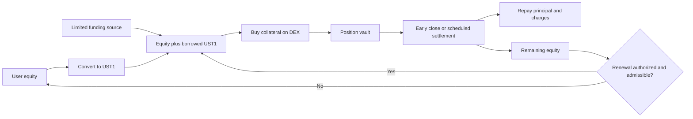

# Leverage on the swap page

Research date: 2026-10-13. Status: design research, not an approved risk policy or implementation. Dollar examples assume 1 UST1 = $1; the contracts must account in actual token units and separately track backing and redemption risk.

## Feasibility assessment

**The simple user experience is feasible. The proposed periodic-reset mechanism does not, by itself, make 10×–100× leverage safe for the CMM.** It creates a collateralized, non-recourse spot loan with a fixed settlement term and optional automatic renewal. The CMM finances the purchase and bears losses beyond the user's equity. A timer replaces price-triggered liquidation; it does not eliminate credit risk, execution risk, or the need for someone to price those risks.

The proposal has three promising directions:

1. **An explicitly capped pilot:** isolated, prefunded UST1 lending; conservative asset admission; permissionless settlement; and a funded reserve that bounds the CMM's total exposure. This most closely preserves the proposed mechanics.
2. **Reserved exit liquidity or fully collateralized downside protection:** a borrowing-of-liquidity design, similar in principle to InfinityPools, could support higher leverage without relying on a liquidation-price oracle. Its protection must be financed by willing liquidity providers. This is a different financial primitive and a larger engineering project.
3. **External risk capital:** lenders fund asset-specific term markets and accept collateral in default, as in Timeswap. The same slider can front this product while limiting the CMM's contribution to an explicit amount.

The research does **not** support launching unprotected 10× cUSTC with either daily or hourly resets. In the historical screen below, USTC lost 26.30% in one hour and 44.92% over 24 hours. A 10× position can cover less than a 10% fall after costs. Even BTC and ETH exceeded relevant daily buffers. These observations establish counterexamples, not a forecast or a safe leverage limit.

**Recommendation:** preserve the slider idea; prototype the economics before promising a maximum. Prefer prefunded lending for the first version, and investigate reserved-liquidity protection if 10×–100× is a firm product requirement. New unsecured UST1 mint authority is a separate monetary-policy decision, not a shortcut around the cost of capital.

## 1. What the product actually does

At 1×, the user makes the current spot swap. At more than 1×:

1. Convert the user's input to UST1, unless it is already UST1. Let the actual net proceeds available as equity be `E`.
2. Borrow or issue `B = (L − 1)E` UST1, where `L` is the selected leverage.
3. Spend approximately `LE` UST1 buying the selected collateral asset. Entry costs reduce the actual quantity received.
4. Lock that quantity in a position vault. Record the owner, collateral quantity, principal, agreed term charge, next maturity, renewal authorization, and applicable risk limits.
5. At the scheduled settlement, realize collateral into UST1, repay principal and charges, and calculate remaining equity.
6. If renewal is authorized and still admissible, borrow against that remaining equity and buy again. Otherwise return the remaining equity and close.

The initial version is a **long position in the purchased asset relative to UST1**. Selling asset A to open a leveraged position in B is not a leveraged A/B pair trade: A has been sold and there is no ongoing short exposure to A. Supporting shorts would require borrowing the base asset or another mechanism with different tail risks. The quoted return is also not necessarily the asset's USD return if UST1 changes value.

An open position is a claim on locked assets after debt, not spendable tokens delivered to the wallet. A user may close early, request a reset, repay externally to release collateral, or add equity, subject to the signed permissions and supported settlement paths. A position receipt is optional; a separate contract instance is not required just to maintain separate accounting.



This resembles spot margin trading plus a periodically rebalanced leveraged fund. Contango already presents borrowing and spot execution as one transaction; its underlying lending markets still own liquidation risk. Gearbox uses restricted credit-account contracts to hold and use borrowed funds. These precedents support the UX and custody idea, not the proposed loss guarantee. [Contango mechanism](https://contango.exchange/), [Gearbox credit-account discussion](https://blog.gearbox.finance/the-end-of-looping-on-gearbox/).

## 2. Correct accounting and the worked example

Use a declared day-count convention, such as ACT/365. Let:

| Symbol | Meaning |
| --- | --- |
| `E` | Equity in UST1 available before the leveraged purchase |
| `L` | Leverage at the reset |
| `B` | Borrowed principal: `(L − 1)E` |
| `a` | Borrowing APR as a decimal |
| `τ` | Agreed term in years |
| `I` | Fixed term interest: `B × a × τ` |
| `f` | Flat service charge for the term |
| `D` | Amount due: `B + I + f` |
| `A` | Actual net UST1 recovered from collateral |

For the user's example, assuming no entry or exit friction:

| Item | Correct amount |
| --- | --- |
| Initial equity | 1 UST1 |
| Leverage / purchase | 10× / 10 UST1 |
| Borrowed principal | 9 UST1 |
| One-day interest at 30% APR | `9 × 0.30 / 365 = 0.00739726` UST1 |
| Flat charge | 0.10 UST1 |
| Total term charge | 0.10739726 UST1 |
| Total amount due | 9.10739726 UST1 |
| Sale after a 5% price fall | 9.50 UST1 |
| Remaining equity | 0.39260274 UST1 |
| Next 10× purchase, before new entry friction | 3.92602740 UST1 |
| Next borrowed principal | 3.53342466 UST1 |

The daily APR charge is **8.219178 basis points of borrowed principal**, not 8.2 basis points of equity. The suggested total of `$0.1008` understates interest by roughly tenfold; `$0.1074` is the appropriate rounded amount under these assumptions. DEX fees, taxes, price impact, and any extra settlement cost worsen the result.

For integer implementation, avoid silently rounding the hourly rate to zero. At 15% APR, a one-hour term is only 0.171233 basis points. Storing an integer basis-point term rate would erase it; rounding it up to 1 bp would charge about 87.6% annualized. Store sufficient fixed-point precision, multiply in wide integers, round the final charge by a specified rule, and quote the exact raw-unit liability. A fixed charge simplifies accrual, but it does not remove precision, default, or renewal accounting.

Charging the entire term even on early close is possible, but describe it as a **fixed term charge**. APR alone is misleading for an early exit. Record the full agreed charge once; do not charge it again when a keeper retries. If an early reset opens another term, that new charge must be separately visible and authorized.

### Who gets paid when proceeds are insufficient?

Define a waterfall before implementation. A defensible starting point is execution costs necessary to recover value, then principal, then earned service/interest claims, then user residual. Keep operational costs and keeper incentives explicitly funded so priority disputes do not stop settlement.

Distinguish:

- **Face shortfall:** `max(D − A, 0)`.
- **Principal loss:** `max(B − A_principal, 0)`, where `A_principal` is the recovery actually available for principal after permitted senior costs.
- **Uncollected income:** unpaid interest and service charges.
- **Incremental economic loss:** principal impairment plus actual expenses and backing obligations, minus realized recoveries; compare funding income separately when measuring profitability.

Forgone interest is not identical to lost funded principal. Record both; do not inflate cash losses by treating all quoted income as money the CMM already paid out, or hide expenses by counting only principal.

There is also a mechanical contradiction to resolve in the proposed default branch: **once all cUSTC has been sold, there is no cUSTC left to transfer to the CMM.** Choose one of these explicit outcomes:

| Outcome | Accounting |
| --- | --- |
| Sell collateral for UST1 | Apply actual proceeds; recognize the unrecovered liability; close or enter recovery |
| Seize unsold collateral | Transfer custody to an isolated recovery vault; retain impairment accounting; book recovery only when realized or conservatively valued |
| Partial sale | Track both recovered UST1 and remaining collateral without double counting |

Merely transferring underwater collateral to the CMM does not repay or burn issued UST1. Keeping a bad position open also does not postpone the economic loss.

## 3. Loss buffers and maximum leverage

Ignoring execution friction, with asset return `r` over a term:

```text
A = LE(1 + r)
Equity_after = max(A − D, 0)
Face_shortfall = max(D − A, 0)
r_break_even = −1/L + ((L − 1)/L)aτ + f/(LE)
```

Here “break even” means the collateral just covers the entire amount due, not that the user earns a zero investment return. Below that price, the position has no residual equity.

| Leverage | Ideal adverse move exhausting equity, before all costs |
| --- | --- |
| 2× | 50% |
| 3× | 33.33% |
| 5× | 20% |
| 10× | 10% |
| 20× | 5% |
| 100× | 1% |

For a 10× one-day position at 30% APR with the $0.10 fee, the buffer is **8.9260% for $1 equity** and **9.9160% for $100 equity**, before DEX costs. For 100× with $100 equity, the same assumptions leave only **0.9176%**. Small costs become material when the initial buffer is this narrow.

Include entry and exit friction explicitly. If `h_in` and `h_out` are fractional haircuts, and `k` is any additional charge taken from settlement proceeds, excluding charges already represented by `f`:

```text
A = LE(1 − h_in)(1 + r)(1 − h_out) − k
r_required = (D + k) / [LE(1 − h_in)(1 − h_out)] − 1
```

For a specified stress fall `d`, define `m = (1 − h_in)(1 − d)(1 − h_out)`. A sufficient condition to cover the full amount due in that scenario is:

```text
L <= [(1 + aτ) − (f + k)/E] / [(1 + aτ) − m]
```

This is a scenario bound, not a prediction. If there are no costs, it reduces to `L <= 1/d`. If the expression gives less than the requested minimum leverage, the market/size/term combination is unavailable.

### Prices and liquidity must be modeled together

For a fee-free constant-product pool holding `x` collateral and `y` UST1, selling `q` collateral returns:

```text
UST1_out = yq / (x + q)
Average_price / Pretrade_spot_price = 1 / (1 + q/x)
```

Selling collateral equal to 10% of the pool's collateral reserve already gives about 9.09% less than the pretrade spot valuation. That can consume nearly the entire ideal 10× buffer before any market fall. This is an illustrative v2-style calculation; the actual CL8Y pool/book/hook route must be simulated using its own semantics. The derivation follows the constant-product model in the [Uniswap v2 whitepaper](https://uniswap.org/whitepaper.pdf).

Fee exemptions do not remove price impact, spreads, sandwiching, inventory risk, or adverse selection. Conversely, an immediate fee-free sell and buy in the same isolated constant-product pool, with no intervening trades and exactly reversed amounts, need not incur two independent permanent impact losses: the pool state reverses. Avoid double counting that special case. Real multi-route resets, debt repayments, arbitrage, changed position size, and competing orders require transaction-level simulation.

## 4. Periodic re-leveraging changes the payoff

For constant target leverage and frictionless successful resets:

```text
E[n+1] = max(E[n] × (1 + Lr[n] − (L − 1)a[n]τ[n]) − f[n], 0)
```

Once a position defaults, this recurrence stops; the CMM separately records any shortfall. It cannot continue into negative user equity while pretending the remaining loan is covered.

Resetting is path dependent. Suppose the asset rises 5%, then falls 4.7619%, returning exactly to its initial price. At 10×, with a reset between the moves and no costs:

```text
User equity: 1 -> 1.5 -> 0.785714
Asset return over both periods: 0%
User return: about −21.43%
```

The rule increases exposure after gains and reduces it after losses. It can compound gains in a trend and erode equity in a choppy market. It is different from a fixed-quantity margin position. The leveraged-ETF literature documents this path dependence; a continuous-rebalancing approximation gives a variance penalty proportional to `L(L − 1)σ²/2`, in addition to financing and trading costs. That approximation assumes diffusion prices and continuous rebalancing; it is not an exact model for hourly/daily jumps or defaults. [Avellaneda and Zhang, published 2010; working paper](https://math.nyu.edu/inmemoriam/avellaneda/LeveragedETF20090515.pdf).

Between resets, leverage also drifts. Ignoring fees, after a 5% fall, a 10× position holds 9.5 of assets against 9 debt and 0.5 equity: its current leverage is **19×**, not 10×. The slider should represent the target leverage at opening/reset, rather than promise a constant multiplier at every moment.

### Rebalance the difference rather than always selling everything?

Potentially. If current collateral value is `V`, total liability is `D`, and remaining equity is `E' = V − D`, target assets are `LE'` and target principal is approximately `(L − 1)E'` after fees. Sell enough collateral and repay debt when target size falls; borrow and buy the difference when it rises.

This can save gross trading and gas. However, setting debt against unsold assets requires a valuation rule or a structurally protected liquidity model. A manipulable quote cannot safely authorize additional debt. Netting is therefore an optimization after the settlement primitive and admission model are proven, not a free way to eliminate market pricing. Preserve a safe close even when renewal or netting fails.

## 5. Historical screen: what actually happened

This report includes an original descriptive screen of **163 public Binance monthly spot archives**, each verified against its SHA-256 checksum. The script and complete result/provenance are included:

- [Reproduction script](docs/research/leverage/market-screen.py).
- [Results, missing-hour records, archive URLs and hashes](docs/research/leverage/market-screen.json).
- [Binance's archive specification](https://github.com/binance/binance-public-data).

Method: hourly closes; rolling 1-, 24-, and 168-hour simple returns; start at every eligible hourly close; exclude windows spanning missing bars; no forward filling. BTC and ETH cover calendar 2021–2025. USTC/BUSD covers June 2022–May 2023; USTC/USDT covers June 2023–December 2025. The USTC series use different quote currencies and are **not spliced**. The script handles Binance's January 2025 timestamp-unit change.

| Market and sample | Worst 1-hour return | Worst 24-hour return | Worst 7-day return |
| --- | --- | --- | --- |
| BTC/USDT, 2021–2025 | −8.95% | −20.40% | −37.43% |
| ETH/USDT, 2021–2025 | −13.08% | −33.49% | −48.34% |
| USTC/BUSD, Jun 2022–May 2023 | −17.76% | −43.10% | −52.85% |
| USTC/USDT, Jun 2023–Dec 2025 | −26.30% | −44.92% | −44.29% |

Two USTC/USDT counterexamples are particularly relevant:

- **One hour:** 2025-10-10 21:00 → 22:00 UTC, −26.3048%. With $100 equity and $900 principal at 10×, the ideal sale would recover about $736.95, leaving **$163.05 of principal loss**, before financing or execution costs. [October 2025 source archive](https://data.binance.vision/data/spot/monthly/klines/USTCUSDT/1h/USTCUSDT-1h-2025-10.zip).
- **24 hours:** 2023-11-27 08:00 → 2023-11-28 08:00 UTC, −44.9207%. The same $1,000 position would recover about $550.79 and lose **$349.21 of principal**, before costs. [November 2023 source archive](https://data.binance.vision/data/spot/monthly/klines/USTCUSDT/1h/USTCUSDT-1h-2023-11.zip).

In the USTC/USDT sample, 14 of 22,679 eligible hourly windows fell more than 10%; 725 of 22,656 daily windows did. **Those daily windows overlap; they are not 725 separate crashes or independent default trials.** Do not sum their hypothetical losses into a portfolio backtest.

Reciprocal worst-drop bounds illustrate why unprotected leverage must be lower than the desired slider maximum:

| Market | Ideal leverage just covering the sampled worst 1-hour fall | Ideal leverage just covering the sampled worst 24-hour fall |
| --- | --- | --- |
| BTC/USDT | 11.17× | 4.90× |
| ETH/USDT | 7.65× | 2.99× |
| USTC/BUSD | 5.63× | 2.32× |
| USTC/USDT | 3.80× | 2.23× |

These are **zero-cost historical boundaries, not recommended limits**. At the boundary there is no safety margin. A real cap must be lower or protected, and must consider simultaneous positions and their execution into available liquidity. A worst sampled seven-day return need not exceed the worst sampled daily return because the endpoints and recoveries differ; all shorter horizons and outage extensions still need stress testing.

Limitations are material:

- These are CEX prices in USDT/BUSD, not executable cUSTC/UST1 prices on Terra Classic. cUSTC adds wrapper, mint, redemption, and contract risks; UST1 adds backing and conversion risks.
- Hourly closes miss intrahour extremes. User-triggered closes/resets can occur inside the hour. There are missing historical bars, and excluded windows may contain severe events.
- The five-year BTC/ETH sample excludes March 2020. The shorter USTC samples exclude the original May 2022 UST collapse. They cannot be called a full USTC business-cycle validation.
- No current DEX depth, order-book resilience, keeper outage distribution, current backing inventory, borrower flow, or exploit probability has been calibrated here.
- Historical maximum loss is not a future bound. New assets and new contracts do not inherit BTC's history.

This is enough to reject a claim that one-hour resets make unprotected 10× cUSTC safe. It is not enough to approve 2×, 3×, or any specific production parameter.

## 6. The clock does not guarantee execution

Smart contracts do not wake themselves up. A keeper, user, or another transaction must execute settlement, and chain halt/censorship can prevent all of them. Removing an external liquidation feed removes one dependency while retaining transaction inclusion and market-liquidity dependencies.

The relevant risk horizon is:

```text
Effective_horizon = agreed term + permitted grace + actual execution delay
```

During a serious halt, execution delay may have no useful predetermined upper bound. An hourly term cannot be modeled as guaranteed hourly risk. Longer intervals generally expose the lender to larger moves, but a monotonic APR curve is a chosen conservative policy, not a mathematical theorem about every asset and regime.

Use a fixed schedule to prevent accidental drift, while giving each position a deterministically assigned phase to spread keeper load:

```text
anchor = creation epoch plus assigned phase
due[k] = anchor + k × interval
```

An opening should receive the agreed full initial term. Do not give a user entering near a shared modulus boundary only a few seconds while charging a full day. Reserve capacity for the intended cohort when scheduling.

For a 24–25-hour execution window, the next normal due time stays pinned to the original schedule. After a multi-term delay, close/recover first and re-admit any renewal at a future scheduled epoch. Do not execute a series of fictitious missed resets or charge flat keeper fees for transactions that never happened. A shortened catch-up term needs its own explicit quote and authorization.

If users request an early reset, define whether it consumes the remaining term or starts a new full term. Prevent timing changes from refunding mint/issuance quota, resetting the same keeper reward, or extending old credit indefinitely without re-admission.

Fixed phases are load distribution, not protection against MEV. Every due position can still be targeted. Keep total due notional per window within stressed liquidity and keeper throughput, and account for information available to attackers.

## 7. Making the five-year CMM loss budget meaningful

The desired example is `$1m eligible fees × 5% = $50k maximum loss`. There are two materially different promises.

### Statistical target

One can aim for, for example:

```text
Expected five-year losses <= $50k
AND
Probability(five-year losses > $50k) <= an approved tolerance
```

A tolerance such as 1% is an illustrative governance decision, not inferred from the user's requested 5% fee fraction. Expected loss alone says little about catastrophic outcomes. Also constrain Expected Shortfall, concentrated exposures, exploit losses, liquidity stress, and reserve exhaustion.

Even in a simplistic independent-period model, keeping the chance of *any* default below 1% across five years requires a daily default probability of approximately 0.00055%, or an hourly one of approximately 0.000023%. Independence is unrealistic, and any-default probability is different from exceeding a dollar loss budget, but the example shows why a conventional one-day 99% VaR is inadequate.

Five years is a useful reporting horizon, not a guaranteed full business cycle or evidence that tail events have all been sampled. Use longer histories where meaningful, event scenarios, and explicit contract/bridge failure assumptions.

### Enforceable capital limit

To make a hard bound credible, define eligible fees as **realized, retained, economically earned CMM revenue** in an explicit accounting period. Exclude LP fees owed to others, unpaid APR, internal transfers, artificial exempt-reset volume, and unbacked/self-minted tokens. Forecast revenue is not available loss-absorbing capital.

A conservative cumulative accounting rule is:

```text
Approved_budget[t] = min(operator budget, 5% × realized eligible fees[t])
Remaining_budget[t] = Approved_budget[t] − cumulative charged losses[t]
Worst_case_existing_exposure + worst_case_new_exposure
    + funded operating obligations <= Remaining_budget[t]
```

With zero collateral recovery as the catastrophic case, worst-case loan exposure is outstanding funded principal. Add expenses, open protection obligations, and any extra enforceable backing liability. Do not substitute the user's equity or a normal-market haircut for a zero-recovery exploit scenario.

If $50k is already earned, allocated, and available, and no losses or other obligations exist, an unprotected $50k principal cap could support only about **$55,556 gross open notional at 10×**, or **$50,505 at 100×**. Leverage does not multiply the amount of lender capital safely at risk. Lower per-asset and shared-security-domain limits would further restrict capacity.

As losses consume the reserve, new exposure must shrink. Safe repaid principal frees outstanding capacity; it does not erase prior realized losses. Unrealized recovery assets cannot automatically refill a cash loss budget. A fixed five-year cap, expanding accrued-fee cap, and rolling-five-year cap require different ledgers; choose one explicitly. The cumulative accrued-fee approach is more conservative than borrowing against hoped-for future fees.

A hard bound is conditional on correct contracts, backing enforcement, and the absence of a bypass through governance or other CMM facilities. **An unlimited mint permission or unlimited CMM approval defeats the bound.** Enforcement must reside in the funding/backing layer, outside arbitrary per-position logic, with compartmentalized custody. A model cannot guarantee a maximum loss against arbitrary compromise of all of those controls.

### Consolidate the CMM balance sheet

The CMM may simultaneously own LP inventory, back UST1, support wrapping/bridging, and finance leverage. A cUSTC exploit can damage all these positions together. Count the leverage reserve, CMM LP loss, wrapper shortfall, bridge obligations, and peg defense in one scenario. Fees paid by one CMM-controlled contract to another are not new consolidated revenue. Existing collateral or LP positions cannot be counted twice as backing and an independent insurance fund.

Taking underwater cUSTC onto the CMM balance sheet may also incur later losses; impairment must follow the recovery inventory until final disposal. Define whether the 5% budget covers all these incremental losses or only a narrowly specified lending book. The broader promise requires broader controls.

## 8. UST1 issuance and backing

Minting UST1 creates an asset for the trader and a liability for the monetary system. Its economic cost is not zero because the chain accepts a mint message. If holders can redeem against existing backing, credit-issued UST1 can consume that backing while leaving the system holding risky cUSTC.

The repository currently describes vFDUSD-to-UST1 mint/redeem through an oracle window, with pause and staleness checks, and a separate secondary AMM. It also contains an owner-gated Bridge-Debt issuer with exact paired receipt accounting and issuance limits; the documentation explicitly says those controls are not a collateral guarantee. Neither reference establishes an approved retail UST1 credit facility. [UST1 window/operations](docs/runbooks/ust1-wrap-production-ops.md), [secondary-market rules](docs/runbooks/ust1-secondary-amm-pair.md), [Bridge-Debt design](docs/runbooks/deploy-usdt-ust1-lp.md).

Choose the funding model deliberately:

| Model | Benefit | Main constraint |
| --- | --- | --- |
| Lend existing UST1 from a dedicated reserve | Does not expand UST1 supply just to grant leverage; clear lender balance sheet | Requires genuine prefunded inventory and redemption/withdrawal liquidity |
| Mint against dedicated backing reserved for each credit amount | Can keep issued supply backed independently of risky trade collateral | Consumes backing capital and needs accounting across issuance, redemption, repayment, and defaults |
| Mint against the purchased volatile asset alone | Capital efficient in ordinary conditions | Explicitly introduces risky credit backing, contagion to UST1 holders, and recapitalization requirements |
| External UST1 term lenders | Moves credit exposure to consenting lenders | Finite appetite and depth; lenders need transparent default terms |

For credit-issued principal, repayment must burn the corresponding principal or otherwise reconcile the liability under the chosen monetary design. Collecting interest as revenue is separate from retiring principal. Default must leave a visible unrecovered obligation and a funded recapitalization path; wiping the position's debt record cannot destroy circulating UST1.

“Oracle-free leverage” would still not make the existing UST1 backing/window or underlying wrappers oracle-free. Close and recover through supported secondary paths without disabling the current window's staleness checks. Treat common failure of the settlement asset and collateral as a separate systemic scenario.

## 9. What avoiding oracles can and cannot achieve

Three ideas should be distinguished:

- **No external price feed:** contract logic obtains no Chainlink-style observation.
- **No price-based liquidation:** settlement is due by time or uses a contractual option.
- **No price risk for the lender:** recovery is structurally guaranteed in the promised asset or the lender explicitly accepts a different payoff.

The proposed timer can achieve the second and potentially the first. It does not achieve the third.

### Execute-only term settlement

At expiry, sell real collateral and distribute actual UST1. A manipulated numerical oracle cannot directly fabricate repayment: it takes delivered tokens to satisfy debt. Nevertheless, market manipulation, routing control, LP withdrawal, sandwiching, mint exploits, and illiquidity can still make the **real execution price** harmful.

At entry or renewal, the contract still needs to decide whether assets received support new debt. A same-pool spot quote or immediate round-trip quote is not independent evidence of sustainable value. In an attacker-controlled/temporarily inflated pool, newly minted UST1 can purchase collateral from the attacker even though the purchased tokens remain locked. Approval and security limits must cover this attack before funding. A TWAP introduces a price oracle with latency and manipulation assumptions; call it that. The [Uniswap v2 paper](https://uniswap.org/whitepaper.pdf) explains both spot-price manipulation and the cost/latency tradeoff of TWAPs.

### Reserved exit liquidity / collateralized protection

Suppose collateral quantity `q` has an enforceable right to sell at strike `K`, with `qK` covering debt and the necessary settlement costs. If the UST1 leg is funded and reserved for the entire term, repayment does not depend on finding market liquidity after a crash. Physically deliver the collateral to exercise the right; the protection seller receives the depreciated asset.

InfinityPools implements a related idea by borrowing concentrated AMM liquidity. Its protocol description explains that below the specified level the repayment can be in the collateral asset rather than the original quote asset. The safety argument therefore depends on the liquidity obligation and permissible repayment assets, not a conventional fixed-UST1 loan magically becoming riskless. [InfinityPools mechanism](https://docs.infinitypools.finance/protocol-overview/introduction).

For CL8Y, this needs a purpose-built reserved-liquidity or physical-option primitive. An ordinary stop order, AMM position, or promise to provide liquidity later does **not** guarantee exit at a strike. LP capital cannot be withdrawable while simultaneously promised to the vault. If the CMM supplies both the credit and protection, its consolidated downside has not been removed. High leverage must be affordable after the upfront premium, and protection must last through settlement/expiry handling, including delayed chain execution.

Physical delivery can avoid a numerical exercise oracle. Off-chain pricing, underwriting, collateral/token integrity, contract safety, and chain liveness remain. A fully funded seller should reserve the actual settlement asset; a USDC option is not automatically protection for an exact UST1 liability.

### Liquidity-denominated borrowing

Frax BAMM lends AMM liquidity and measures collateral/debt in terms of token-balance products rather than a fixed amount of stablecoin. Its docs describe a solvency condition involving `sqrt(XY)` and identify interest accumulation as an eventual source of liquidation risk. This is a useful oracle-free primitive to study, but it changes the debt denomination and exposure from this proposal. Price-move solvency under a particular invariant is not protection against a worthless, malicious, or frozen token. [BAMM overview](https://docs.frax.finance/bamm/overview).

## 10. Comparable projects and what to learn

These are mechanism comparisons; documentation and papers do not certify their deployment status, solvency history, or suitability for a CosmWasm port.

| Project | Relevant mechanism | Useful lesson / tradeoff |
| --- | --- | --- |
| [Contango](https://contango.exchange/) | Automates flash funding, spot execution, collateral deposit, and borrowing | The slider can hide lending mechanics. Underlying money markets and liquidations remain dependencies. Correlated-asset looping is a different risk case from cUSTC/UST1. |
| [Gearbox](https://static.gearbox.fi/docs/Gearbox.pdf) | Borrowed funds operate inside restricted credit accounts | Strong precedent for constrained vault permissions. Account isolation does not eliminate shared code, collateral, or lending-pool failures. |
| [Timeswap](https://timeswap.gitbook.io/docs) | Fixed-term loans without price-based liquidation or external oracles | Closest credit-payoff comparison: borrowers can forfeit collateral at maturity. Risk is priced and accepted by capital providers; it has not disappeared. |
| [Timeswap lender documentation](https://timeswap.gitbook.io/docs/introduction/market-participants/lenders) | Lenders receive quote assets or collateral depending on repayment/default | A CMM acting as lender must underwrite the collateral outcome. Fixed rate does not mean fixed realized USD return. |
| [Ajna](https://www.ajna.finance/pdf/Ajna_Protocol_Whitepaper_01-11-2024.pdf) | Lenders choose price buckets; bonded participants initiate liquidation auctions | Removes external feeds but retains liquidation participants and market-informed lender decisions. A liquidator bond discourages spurious liquidation; it is not a universal downside guarantee. |
| [InfinityPools](https://docs.infinitypools.finance/protocol-overview/mechanism-details/swappers) | Borrowed liquidity provides contractual swapping rights | Study structural repayment protection rather than a periodic forced sale. Capital is committed by LPs, and lending safety is distinct from the LP's economic payoff. |
| [Frax BAMM](https://docs.frax.finance/bamm/overview) | Liquidity rental with product-based solvency accounting | Alternative oracle-free structure, with a different debt unit, collateral composition, and interest-driven risk. |
| [Curve crvUSD / LLAMMA](https://docs.curve.finance/developer/crvusd/llamma-explainer/) | Arbitrage progressively converts collateral to the debt asset across bands | Softer deleveraging can improve user experience, but it uses oracle information and incurs rebalance losses; hard liquidation can still occur. |

Useful further distinction: a perpetual contract can also sit behind a simple leverage slider. If high leverage is essential but spot-loan protection is too expensive, compare the same UX over perps, capped option exposure, and leveraged spot. Users' lack of interest in the financial primitive is a reason to optimize the interface, not to ignore the primitive's risk allocation.

## 11. Failure cases that must inform the design

| Case | Observed failure | Application to this proposal |
| --- | --- | --- |
| MakerDAO, 12 March 2020 | Congestion and reduced keeper competition allowed zero-bid collateral auctions and system debt. The contemporaneous forum record describes the combined failure. [Response thread](https://forum.skyeco.com/t/black-thursday-response-thread/1433). | A timer still needs included transactions and buyers. A conservative collateral ratio cannot guarantee auction recovery during a combined liquidity/liveness failure. |
| Maker liquidation redesign | Dutch auctions and atomic purchase mechanisms were introduced to improve bidding/capital requirements. [MIP45](https://github.com/sky-ecosystem/mips/blob/master/MIP45/mip45.md). | Analyze auction and keeper incentives, gas, concurrency, and contingency settlement rather than relying on one bot. |
| Venus LUNA, May 2022 | The LUNA feed stopped at a floor while spot prices kept falling, enabling borrowings against stale values; the initial update reported about $14.2m shortfall. [Incident update](https://community.venus.io/t/venus-protocol-luna-incident-update-2/2654). | A frozen “safe” price must not permit new credit. Check source bounds, age, and disagreement; pause issuance while preserving consistent repayment/recovery paths. |
| Euler, March 2023 | A missing account-health check in `donateToReserves` enabled a liquidation-based exploit. [Euler's retrospective](https://www.euler.finance/blog/war-peace-behind-the-scenes-of-eulers-240m-exploit-recovery). | Every collateral/debt mutation and callback needs complete invariants. Extra vault instances do not fix a bug in shared code. |
| Ronin bridge, 2022 | The project's recovery announcement documents drained backing, reimbursement, and added withdrawal controls. [Bridge reopening and controls](https://blog.roninchain.com/p/the-ronin-bridge-is-open-). | A local price history does not bound remote-custody failure. Bridge-backed collateral and settlement assets can suffer correlated loss. |
| Historical USTC hourly/daily falls | The original screen above contains falls much larger than 10× margins. | Scheduled resetting is not a substitute for underwriting jumps. Selling into depleted DEX liquidity can worsen the shortfall. |
| Unsupported token behavior | Ajna's repository explicitly excludes fee-on-transfer and rebasing assets from compatibility. [Token caveats](https://github.com/ajna-finance/ajna-core). | Integration semantics matter: supported CL8Y tax/hooks must be modeled exactly; arbitrary token behavior cannot be treated as ordinary collateral. |

These failures represent different categories. Better pricing cannot repair a compromised bridge; lower leverage cannot compensate for unlimited mint authority; additional bots cannot transact on a halted chain.

## 12. Security admission and shared exposure limits

Financial limits and security limits must be separate inputs to the admitted amount. For each position:

```text
Allowed_credit = min(
    size-specific financial limit,
    asset outstanding limit,
    shared issuer/bridge/security-domain limit,
    new-issuance throughput limit,
    stressed exit-liquidity limit,
    settlement-cohort capacity,
    remaining funded global loss budget,
    owner/position limit
)
```

Per-wallet limits are convenience controls, not Sybil-resistant security boundaries. Token-global, issuer-global, shared-bridge, route, and global caps must hold even if an attacker uses thousands of wallets.

Whitelisting should pin the actual token implementation/code hash where available, decimals, minter set and caps, migration/admin powers, freeze/blacklist behavior, tax/hooks, wrapper backing, redemption throughput, and routing dependencies. A trusted token can become unsafe when a minter or wasm admin changes. On negative integrity signals, stop new borrowing and renewal; preserve supported principal repayments, owner withdrawal after repayment, and recovery.

For cUSTC specifically, model this attack path:

1. An attacker exploits minting or obtains tokens whose backing cannot be recovered.
2. They sell some through the DEX and use other tokens as input/equity for leveraged purchases, or sell to vault purchases during a manipulated market.
3. The leverage funding source adds UST1 buying power and can deliver additional liquid value to the attacker without using the wrapper's native withdrawal path.
4. Wrapper/bridge rate limits therefore do not bound the total extraction unless the new credit channel shares a consolidated security budget.

Track existing outstanding leverage plus newly extracted liquid value across routes. Count gross issuance/turnover over sliding and fixed windows; a repayment does not refund throughput quota. Fixed epoch limits alone allow two full bursts around a boundary, so use an additional rolling window or token-bucket control where needed. Stress the time until detection and actual pause inclusion, not merely an assumed bot polling interval.

Also test collateral donations, decimal mismatches, balance-query dishonesty, hook reentry, manipulated discounts, same-block opening/closing, fee-exemption laundering, dust, nonce replay, keeper races, griefing with reverting tokens, arbitrary router payloads, and migrations while positions are live. Delisting a token must not erase its debts or strand consistent repayment.

## 13. Settlement execution and fee exemptions

Use permissionless settlement with bounded rewards, multiple independently operated keepers/RPCs, reserved LUNC gas, and observability for overdue positions. Keeper keys must never have arbitrary mint or collateral-transfer authority. A reward is paid once for confirmed useful work, not once per attempted call. Competing callers should converge on the same nonce/state transition.

The intended sequence is:

```text
OPEN -> DUE -> SETTLING -> CLOSED
                       -> RECOVERY
                       -> OPEN with a newly admitted term
```

**Closing old exposure must not depend on successfully opening new exposure.** If new issuance is capped, collateral becomes ineligible, or the renewed purchase fails, old debt should still be repaid and residual equity returned or safely held. Use a reviewed two-phase workflow or bounded submessage/reply handling that can commit the close while rolling back a failed optional renewal. Do not allow a half-minted new loan to survive a failed purchase. CosmWasm provides replies for success/error handling, but the exact rollback boundary needs explicit design and tests. [CosmWasm reply semantics](https://cosmwasm.github.io/core/entrypoints/reply).

Do not set the sale's minimum output to `D` and revert whenever debt cannot be fully repaid: that would strand precisely the underwater positions the system needs to recover. Equally, allowing a keeper to dump collateral at any price gives attackers a recovery-price subsidy. Preserve positive post-hook execution floors; use bounded auction, RFQ, or explicitly governed recovery rules when ordinary protected execution is unavailable. A manipulated same-pool quote cannot serve as an independent recovery bound.

No external price feed is needed to verify that a bid delivered actual UST1. But deciding whether to accept an insufficient bid, delay for a better bid, or seize collateral requires a contractual recovery policy and exposes someone to residual price risk. A delay extends the modeled risk horizon.

### Exempt only the intended maintenance action

The initial entry should retain the user's current CL8Y-based DEX fee treatment. Scheduled maintenance may have a separately authorized fee/tax policy. A blanket exemption attached to a user-accessible vault or router can become a fee-free trading gateway.

Bind any exemption to the authenticated position, collateral and debt assets, operation kind, authorized routes, gross amount, maturity/nonce, exact recipient, and bounded single-use context. Do not accept an arbitrary “this is a reset” user flag. User-triggered closes/resets need a deliberate published fee policy; they should not inherit unrestricted maintenance privileges merely because scheduled resets are exempt.

Token tax exemption requires permission from the token's actual policy controller. It must not bypass freeze, blacklist, launch guards, wallet caps, hook safety, or rate limits. LP fees belong to LPs unless governance and pool contracts authorize a change. Native chain taxes and transaction gas are separate and cannot be waived by a vault's DEX exemption. Unsupported tax/callback semantics must block the asset.

Future implementation must preserve this repository's [net execution floors](skills/AGENTS_NET_EXECUTION_FLOORS.md), [gross route-local tax funding](skills/AGENTS_ROUTE_LOCAL_TAX.md), and [router trust lifecycle](skills/AGENTS_ROUTER_TRUST_LIFECYCLE.md). Research here does not authorize waiving their protections.

## 14. One contract per trade versus shared accounting

Separate contract instances can isolate balances and token allowances. They do not isolate shared minters, oracle assumptions, token exploits, code bugs, wasm administrators, or global funding logic.

| Layout | Benefits | Costs / limits |
| --- | --- | --- |
| Position record in one manager | Lowest likely instantiate overhead; simple pagination and batching | Shared custody and accounting increase the blast radius of a manager bug |
| Per-asset/per-security-domain manager with position records | Separates some custody and permissions while keeping per-trade gas lower | Needs cross-manager global caps and domain-aware risk accounting |
| One vault instance per position | Clear token custody and restricted permissions; identifiable recovery assets | Instantiate/storage/call overhead; large inventory of contracts; shared-code failures remain |

A reasonable prototype is a tightly scoped global funding controller, per-security-domain custody, and minimal position vaults if measured gas supports them. Reuse the position vault across resets; do not instantiate a fresh contract every term. Whether contract-per-position is preferable is a benchmark result, not an assumed security theorem.

Measure on the actual supported Terra Classic runtime:

```text
Overhead = (gas_leveraged_entry_with_vault − gas_same_leveraged_entry_without_vault)
           / gas_same_leveraged_entry_without_vault
```

This isolates the incremental per-vault choice; also report the total increase relative to an ordinary 1× swap. The proposed approximately 20% preference applies to measured overhead, not a guaranteed target. Benchmark create, early close, renewal, failed renewal after successful close, underwater recovery, taxed routes, hook limits, and bounded batches. Include worst observed funded execution, not only empty-book simulation.

Current [offline swap budgeting](docs/adr/0014-swap-auto-gas.md) does not automatically cover a new leverage execute. Independently calibrate its new message family, maintain requested/signed fee consistency, and keep quote/refresh/preflight paths offline as required by [local quote rules](skills/AGENTS_LOCAL_SWAP_QUOTES.md) and [offline execution budgets](skills/AGENTS_OFFLINE_SWAP_BUDGET.md). Do not add per-keystroke RPC/simulation to make the slider work.

## 15. Pricing and operational unit economics

The user's suggested APRs are hypotheses, not calibrated rates:

| Term | Assumed APR | Term charge as bp of principal | Financing charge as % of equity at 10×, excluding flat fee |
| --- | --- | --- | --- |
| 1 hour | 15% | 0.171233 bp | 0.01541% |
| 24 hours | 30% | 8.219178 bp | 0.73973% |
| 7 days | 80% | 153.424658 bp | 13.80822% |

At 10×, financing cost relative to user equity is roughly nine times the debt APR if leverage and equity were held constant. A 30% borrowing APR corresponds to about **270% simple annual financing drag on equity**, before resets, compounding, and all other costs. This does not mean a user pays 270% of their initial deposit in cash; positions shrink or close as equity is depleted. It does mean the cost needs to be shown per term in equity units.

A $0.10 charge is 10% of $1 equity **every reset**. With the daily 30% APR, a flat asset price and no execution friction, the first reset reduces $1 to $0.8926, and the position cannot fund ten complete daily charges under the recurrence. For $100 equity, the flat charge alone is 0.1% per daily reset, about 36.5% simple annualized; for hourly resetting, about 876% simple annualized. These are fixed-size comparisons, not predictions of compounded realized returns.

For the fixed fee alone to be no more than 0.1% of equity each reset, equity must be at least $100. For 0.01%, at least $1,000. A dust/minimum-equity close is essential, and shorter intervals are economically harder for small positions even when financially less exposed to ordinary diffusion risk.

The bot cost is not known to be $0.10. Price it from gas, failed attempts, competing callers, LUNC volatility, retries, infrastructure, and stressed throughput. Keep a flat charge only if it reliably covers those costs at the supported position sizes. Sponsored/batched operations or explicit subsidy may be needed; model their reserve draw rather than presenting them as free.

### The CMM is selling downside protection

For a non-recourse term loan, the lender receives approximately `min(A, D)` while the user owns `max(A − D, 0)`. The face shortfall `max(D − A, 0)` is a put-like payoff. This is an application of the option view of risky debt, not an assertion that a liquid hedge exists for cUSTC. [Merton, 1974](https://onlinelibrary.wiley.com/doi/10.1111/j.1540-6261.1974.tb03058.x).

A useful pricing decomposition is:

```text
Term charge = funding cost + expected credit loss + risk-capital charge
              + operations + hedge/protection cost where applicable + margin
```

Avoid double counting: a hedge premium may replace the modeled covered credit-loss/risk-capital components. Realized collected income, rather than the face value of promised interest, funds profitability. A full model must price credit using the fee-inclusive strike, since higher charges themselves reduce the repayment buffer.

As a deliberately simplified benchmark, a European put on assets initially worth 10 UST1, strike 9 UST1, annual volatility 100%, zero drift/discount rate, and no jumps or execution costs has approximately:

| Term | Put value per initial 1 UST1 equity | Equivalent annualized charge on 9 UST1 principal |
| --- | --- | --- |
| 1 hour | Effectively zero in this diffusion-only model | Effectively zero; the model misses jumps |
| 1 day | 0.004071 UST1 | 16.51% |
| 7 days | 0.168895 UST1 | 97.85% |

These are original calculations using `put = KΦ(−d2) − SΦ(−d1)`, `d1 = [ln(S/K) + σ²τ/2]/(σ√τ)`, and `d2 = d1 − σ√τ`. They are neither cUSTC volatility estimates nor executable option quotes. The zero hourly result is contradicted as a safety model by the observed USTC hourly jumps.

Adding a 15% capital-cost assumption to that benchmark would suggest about 31.5% for one-day debt and 112.9% for seven-day debt before overhead, capital reserves, jumps, and fee-inclusive strike effects. Thus 30%/80% are not inherently generous rates. At higher volatility or leverage they can be inadequate. Conversely, real hedge markets, correlation, utilization, and repayment policies can change the result.

At a 15% assumed funding cost, charging 15% on one-hour loans leaves no interest spread for expected loss, risk capital, or profit. Any remaining surplus must come from realized entry fees, the service-charge margin, external subsidy, or other explicitly modeled revenue.

## 16. The modeling software needed before parameter approval

The included market screen is a reproducible counterexample finder. It is **not** the requested production risk calibrator. Build a portfolio-level simulator with these inputs and outputs:

| Component | Required work |
| --- | --- |
| Market data | Multi-venue subhourly data, cUSTC/native basis, UST1/USD and redemption behavior, historical reserves/books and liquidity withdrawals; flag gaps and regime breaks |
| Position engine | Exact entry fees, taxes/hooks, integer rounding, principal/charge waterfall, chosen interval, fixed phase, early closes, user resets, defaults, optional renewal and dynamic leverage |
| Execution engine | Real route/book semantics, aggregate simultaneous selling, slippage/MEV, failed transactions, bounded routing work, partial auctions, inventory held in recovery |
| Liveness engine | Measured keeper latency, gas shocks, correlated RPC failures, censorship, chain halts and recovery; couple these with adverse markets |
| Security scenarios | Malicious/unbacked mint, bridge loss, freeze/blacklist, administrator compromise, token upgrade, redemption backlog, shared collateral/funding failure |
| Capital engine | Funding utilization, withdrawal demand, staking/capital cost, stable backing, consolidated CMM LP/inventory, reserves and all issuance budgets |
| Borrower behavior | Adverse selection, coordinated entry before known events, profits withdrawn, voluntary de-risking, repeated resets, Sybil accounts, fee-tier behavior |
| Statistical analysis | Historical replay, block bootstrap preserving volatility clusters/correlation, jump/regime models, extreme-value tails, parameter uncertainty, holdout periods |
| Outputs | Net collected fees, user cost/returns, defaults, principal loss, uncollected income, five-year aggregate loss distribution, VaR/Expected Shortfall, reserve exhaustion, and throughput |

Replay complete chronological paths for all positions. Do not sum overlapping rolling returns as losses or bootstrap each token independently. Do not extrapolate a smooth volatility curve to a token exploit that destroys collateral.

Useful baseline parameterization is:

```text
APR(asset, L, term, utilization, regime) = funding_rate
    + expected_loss_rate + capital_charge_rate + operating_margin_rate
```

Rates may be implemented as bounded approved tables/interpolation curves, with per-asset minimum/maximum values and explicit term/leverage restrictions. A rate above the permitted maximum should make that combination unavailable; capping a quote below its required risk price is a subsidy that must consume a budget. Price each new term using current approved parameters, while honoring existing contractual charges.

An illustrative first experiment can compare 1-hour, 4-hour, 24-hour, and 7-day terms at 2×, 3×, 5×, and 10×; these are research grid points, not launch approvals. Include user sizes from dust to stressed pool capacity, and outage extensions from minutes to days. High leverage should not be enabled merely because its average simulated income is positive.

Approve a market only when all of these hold:

1. User cost, expected collected margin, and keeper economics are viable at supported sizes.
2. Portfolio tail losses meet the explicitly chosen statistical objective under parameter uncertainty.
3. Catastrophic exposures obey the funded hard cap independently of the statistical model.
4. Security-domain limits prevent leverage funding from bypassing wrapper/bridge extraction controls.
5. Worst-case execution and safe close/recovery are funded and tested, including failed renewal.

## 17. UX that stays simple and accurate

The swap page can remain familiar: Pay, Buy, leverage slider, cost, and one action. Default to 1×; only admitted markets/amounts offer higher values. Choosing leverage should create a position without exposing internal UST1 hops or contract administration.

The change in ownership and liability does need a concise confirmation:

- `Position size` in the purchased asset and settlement value.
- `Your deposit` and the maximum user loss for the supported non-recourse design.
- `Cost per reset` including the full fixed charge and operation fee, alongside normal entry/network costs.
- `Next reset` and renewal status.
- An appropriate risk acknowledgement and `Open position` action at more than 1×.

“Receive” must not imply that the leveraged tokens arrive spendable in the wallet. An ordinary wallet token balance will not contain them; show the position in holdings with clear equity/P&L. A simple timer and `Close` control should remain accessible outside the advanced page. Advanced details can expose debt, actual leverage, reset history, asset custody, interval controls, fees, recovery status, and collateral/protection terms.

The basic confirmation must state automatic resetting and possible loss of the entire deposit. Hide implementation details through progressive disclosure, while retaining required acknowledgements and accurate blocking gates. This follows the repository's [retail copy and cognitive-load rules](skills/AGENTS_FRONTEND_COPY_COGNITIVE_LOAD.md).

Renewal authorization should specify maximum term charge/APR, minimum equity, target/capped leverage, slippage bounds, allowed route/asset semantics, and expiry of authorization. A global risk cap may reduce availability; silently renewing at a materially different leverage or cost is not the promised product. If renewal exceeds the user's bounds, close or stop in the agreed safe state. A user can request close at any time, but actual execution remains subject to chain liveness, token integrity, and available settlement paths.

## 18. Development decision and unresolved evidence

**Proceed with a design/simulation prototype. Do not proceed directly to an unprotected 10×–100× credit-mint launch.**

The first prototype should compare two implementations under the same slider: prefunded term loans with a hard CMM budget, and a reserved-liquidity/physical-protection design. Measure gas for shared records and individual vaults using the same economic operations. Validate lower-leverage/shorter-term hypotheses with actual local execution liquidity; do not import CEX-safe-looking parameters into cUSTC.

For any launch, establish funded reserves, monetary authorization, consolidated risk accounting, independently reviewed contracts, permissionless recovery, exact fee/rounding semantics, and measured keepers/gas. Keep production acceptance separate from source tests. Existing issue verifiers become relevant when their contracts/UI boundaries are changed; this research changes no deployed behavior.

Evidence still needed includes current deployable UST1 minter/backing permissions, retained CMM fee revenue, available independent risk capital, local size-specific collateral exit liquidity, wrapper/bridge aggregate limits, measured keeper latency and costs, term demand, vault gas overhead, and security review of the proposed funding/settlement primitive. No numeric production APR, safe leverage, or maximum position size is established here.

## 19. Research papers worth reading

| Paper | Why it matters here | Limitation |
| --- | --- | --- |
| [Merton (1974), On the Pricing of Corporate Debt](https://onlinelibrary.wiley.com/doi/10.1111/j.1540-6261.1974.tb03058.x) | Frames risky lending as promised debt less an embedded downside option | Classical diffusion/market assumptions omit token exploits, MEV, and unavailable liquidity |
| [Avellaneda and Zhang (2010), Path-Dependence of Leveraged ETF Returns](https://epubs.siam.org/doi/abs/10.1137/090760805), [working paper](https://math.nyu.edu/inmemoriam/avellaneda/LeveragedETF20090515.pdf) | Explains periodic-reset compounding and volatility drag | ETF replication is not the same as discrete on-chain non-recourse credit |
| [Qin et al. (2021), An Empirical Study of DeFi Liquidations](https://arxiv.org/abs/2106.06389) | Studies liquidation incentives, borrower costs, and instability across lending protocols | Historical Ethereum protocol behavior is not a calibrated Terra Classic risk model |
| [Cheng et al. (2021), Liquidation, Leverage and Optimal Margin in Bitcoin Futures Markets](https://arxiv.org/abs/2102.04591) | Uses extreme-value methods; finds Gaussian assumptions underestimate margins in its sample | BTC futures results cannot be copied into cUSTC term-loan limits |
| [Sardon (2021), Zero-Liquidation Loans](https://arxiv.org/abs/2110.13533) | Describes structured loans with repayment in cash or pledged collateral and lender downside exposure | A proposal, not evidence that low-rate high-leverage lending has bounded USD loss |
| [Ngo (2022), Timeswap V2 whitepaper](https://timeswap.io/whitepaper.pdf) | Formal oracleless fixed-maturity market and options construction | Requires risk-taking counterparties and an additional market design |
| [Ajna Protocol whitepaper (January 2024 file)](https://www.ajna.finance/pdf/Ajna_Protocol_Whitepaper_01-11-2024.pdf) | Lender price buckets, liquidation bonds, auctions, and market-derived rates | Removing external feeds does not remove risk assessment or liquidation liveness |

The defensible product thesis is: **users can open simple leveraged spot positions without choosing a perp interface; financing, downside ownership, and exit liquidity must still be explicit in the protocol.** A five-year loss fraction can be a useful underwriting target and a funded exposure constraint. Periodic renewal alone cannot enforce it.
